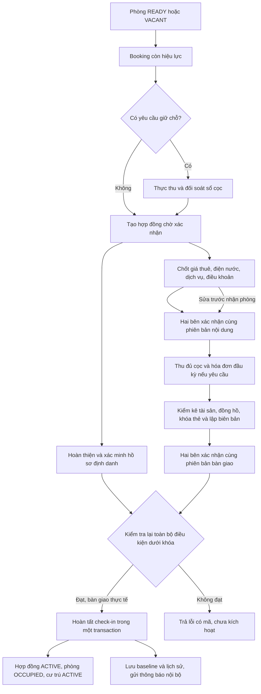

# Prompt 05 — Hợp đồng, xác nhận và bàn giao nhận phòng

Ngày thực hiện: 31/10/2026. Phạm vi: mã nguồn hiện có, tiếp nối Prompt 03–04. Không commit, push, reset database hoặc ghi dữ liệu vào database ứng dụng. Các thay đổi chưa commit trước phiên làm việc được giữ nguyên.

## 1. Hiện trạng và lỗi đã phát hiện

| Vấn đề trước sửa | Nguyên nhân và vị trí liên quan trong mã hiện tại | Kết quả sau sửa |
| --- | --- | --- |
| Giá hợp đồng/hóa đơn lấy từ giá niêm yết phòng | `RentalLifecycleRepository.java:153`, `AdminInvoiceRepository.java:45`, các repository hợp đồng | Lưu `contracts.agreed_monthly_rent` khi tạo hợp đồng; đọc giá này trong hợp đồng, hóa đơn, trang chủ người thuê và báo cáo hợp đồng. |
| Hoàn tất check-in tự ghi ngày ký | `RentalLifecycleRepository.java:171` | Chỉ chuyển ACTIVE; `signed_at` được ghi sau hai xác nhận cùng phiên bản. Không dùng ngày này để suy ra hợp đồng cũ đã xác nhận. |
| Checkbox định danh có thể thay thế xác minh hồ sơ | `RentalLifecycleServiceImpl.java:71`, `ContractOnboardingService.java:98` | Hồ sơ phải đủ trường và có bản ghi xác minh khớp fingerprint hiện tại, kèm người thực hiện, thời gian, tham chiếu chứng từ. |
| Thiếu xác nhận độc lập của hai bên | `ContractOnboardingService.java:104` | Lưu phiên bản nội dung, SHA-256, bên xác nhận, actor, thời gian. Không cho cùng actor đại diện cả hai bên trong một phiên bản. |
| Sửa điều khoản không có cơ chế hủy hiệu lực xác nhận trước | `ContractOnboardingService.java:78`, `:90` | Sửa bản chờ tạo phiên bản mới, xóa mốc xác nhận hiện tại trên hợp đồng, giữ nguyên chứng cứ các phiên bản trước. |
| Bàn giao chỉ có thông tin do người quản lý nhập | `ContractOnboardingService.java:128`, `:142` | Lưu snapshot theo phiên bản; bên cho thuê chốt biên bản, người thuê xác nhận đúng hash/version. |
| Snapshot tài sản không kiểm tra đủ/đúng phòng | `ContractOnboardingService.java:122`, `:146` | Kiểm tra ID thuộc phòng, không trùng, đủ danh mục và số lượng; cho ghi tình trạng thực tế, kể cả MISSING. |
| Chỉ có chỉ số hiện tại của đồng hồ, thiếu mốc cho từng hợp đồng | `ContractOnboardingService.java:157`, `AdminInvoiceRepository.java:47` | Lưu baseline theo hợp đồng, loại đồng hồ, mã đồng hồ, chỉ số, check-in, actor và thời gian. |
| Kỳ đầu có thể tính cả tiêu thụ trước bàn giao | `AdminInvoiceRepository.java:47` | Điểm đầu tính tiền không thấp hơn baseline; dùng đơn giá hợp đồng; chặn chỉ số cuối thấp hơn điểm đầu. |
| Phí cố định có thể bị cộng thêm tiền đồng hồ | `AdminInvoiceRepository.java:47`, `RentalLifecycleRepository.java:176` | Không lấy dòng tiêu thụ để tính thêm cho chính sách FIXED; không reset đồng hồ của phòng khi check-in theo phí cố định. |
| Thêm cư trú thiếu kiểm tra sức chứa thực tế | `RoomLifecycleGuard.java:118` | Kiểm tra hợp đồng/phòng, cư trú hiện tại và dữ liệu người ở cùng cũ dưới khóa phòng trước khi thêm. |
| Chưa có liên kết nghĩa vụ thu đầu kỳ với điều kiện nhận phòng | `ContractOnboardingService.java:112`, `:146` | Chính sách riêng trên hợp đồng; liên kết hóa đơn thuê đúng hợp đồng/tháng/giá thuê, yêu cầu thanh toán đủ. Tái sử dụng hóa đơn và payment hiện có. |
| Dịch vụ PER_PERSON vẫn tính một đơn vị | `AdminInvoiceServiceImpl.java:34`, `AdminInvoiceRepository.java:70` | Lấy số hồ sơ cư trú liên kết tại cuối kỳ, tối thiểu một người đại diện; số lượng và số tiền được đóng vào dòng hóa đơn. |

Các số dòng chỉ vị trí triển khai hiện tại để review; bảng mô tả nguyên nhân quan sát được trước khi chỉnh sửa. Không có `.codegraph/` tại repository nên sử dụng tìm kiếm mã nguồn trực tiếp.

## 2. Quy trình sau chỉnh sửa



Việc tạo tài khoản, lập hợp đồng, xác nhận hoặc thu tiền riêng lẻ đều không tự tạo cư trú ACTIVE. Phòng chỉ OCCUPIED khi hoàn tất bàn giao thực tế. Khách đã xác nhận nhưng không đến vẫn ở trạng thái chờ nhận phòng; không có job tự check-in.

## 3. Business rules

1. Giữ các khóa owner → room và kiểm tra xung đột của Prompt 04; khoảng thuê `[start_date, end_date)`. Không mở nhiều hợp đồng chồng lấn trên cùng phòng.
2. Booking CANCELLED/EXPIRED hoặc đã có hợp đồng không được chuyển lại. Luồng thuê trực tiếp dùng booking giữ chỗ bằng 0, không phát sinh khoản thu giả.
3. Giá thuê mới lấy giá thỏa thuận được nhập; API tương thích cũ chụp giá phòng đúng lúc tạo nếu không truyền giá. Hai bên phải xem và xác nhận giá trong snapshot. Giá phòng thay đổi sau đó không đổi giá hợp đồng.
4. Đơn giá điện/nước phải có cách tính METER hoặc FIXED rõ ràng trước xác nhận/nhận phòng. Giá 0 là thỏa thuận không thu; không tự điền đơn giá mặc định.
5. Xác minh định danh yêu cầu họ tên, ngày sinh hợp lệ, điện thoại, loại/số giấy tờ, địa chỉ thường trú và tham chiếu đối chiếu. Fingerprint thay đổi làm bằng chứng cũ không đủ để nhận phòng. Màn hình onboarding không trả số giấy tờ thô.
6. Xác nhận là **xác nhận nội bộ theo phiên bản**, không tuyên bố là chữ ký điện tử được chứng nhận. Backend kiểm tra đúng version/hash và đúng bên; click lặp không tạo xác nhận trùng.
7. Sửa nội dung trước nhận phòng cần lý do; tạo phiên bản mới và hai bên xác nhận lại. Không sửa âm thầm sau ACTIVE hoặc khi đã có hóa đơn chưa hủy. Cọc điều chỉnh qua sổ cọc; không sửa trực tiếp để tránh tiền thực thu.
8. Cọc phải đủ theo ledger có chứng cứ. Hóa đơn thuê đầu kỳ chỉ bắt buộc khi chính sách hợp đồng yêu cầu; số dư phải hết qua quy trình hóa đơn/thanh toán hiện có. Thu cọc và trả tiền thuê là hai nghĩa vụ riêng.
9. Hóa đơn đầu kỳ phải là RENTAL đã phát hành, đúng hợp đồng và tháng bắt đầu, có đúng dòng tiền thuê theo giá đã chốt. Không tự tạo thêm một hóa đơn khác khi check-in; cơ chế chống trùng kỳ tiếp tục áp dụng.
10. Tài sản bắt buộc có đủ snapshot; không chấp nhận tài sản phòng khác hoặc lặp ID. Biên bản mới có thể nạp lại danh mục; bản nội dung trước và xác nhận cũ vẫn được lưu. Chỉnh danh mục sau hoàn tất không sửa snapshot bàn giao đã lưu.
11. Chính sách METER cần đồng hồ ACTIVE đúng phòng, chỉ số không âm và không thấp hơn chỉ số hiện tại. Reset/thay phải ghi sự kiện có lý do, actor và chứng từ trước; không cho sửa số thấp để lách kiểm tra.
12. Phí FIXED không yêu cầu giả lập chỉ số/đồng hồ riêng. Check-in không được ghi đè đồng hồ phòng bằng giá trị 0 được gửi cho loại phí này.
13. Khi tính điện/nước: `đầu kỳ = max(baseline bàn giao, chỉ số trước của kỳ)`; tiền bằng tiêu thụ × đơn giá hợp đồng. Thiếu số cuối, số cuối thấp hơn đầu hoặc thay đồng hồ sau baseline bị chặn để đối soát.
14. Phí PER_PERSON theo số hồ sơ cư trú liên kết tại cuối kỳ. Chưa chia phí theo số ngày ở giữa kỳ; cần điều khoản/phụ thu rõ ràng nếu áp dụng cách khác.
15. Check-in kiểm tra lại trạng thái phòng, bảo trì, thời hạn thuê, booking liên kết, cọc, định danh, xác nhận, thanh toán đầu kỳ, snapshot tài sản, đồng hồ và version. Không tin riêng checklist frontend.
16. Hoàn tất check-in cập nhật phiếu, hợp đồng, phòng, booking, cư trú, đồng hồ/baseline và audit trong cùng transaction. Hai request đồng thời chỉ một request thành công. Lỗi sau cập nhật rollback toàn bộ.
17. OWNER/MANAGER chỉ thao tác trong nhà được sở hữu/phân công. TENANT chỉ đọc và xác nhận hồ sơ của mình. ACCOUNTANT được đọc trong phạm vi và gắn hóa đơn theo quyền thu tiền; không xác minh định danh, ký thay người thuê hoặc kích hoạt. TECHNICIAN không truy cập onboarding.
18. Người ở cùng liên kết vào hợp đồng đại diện, không tạo hợp đồng độc lập để lách chiếm dụng/sức chứa. Rời phòng của người ở cùng không giải phóng phòng đại diện.

## 4. File thay đổi trong Prompt 05

Backend mới:

- `service/ContractOnboardingService.java`: chứng cứ, version, xác nhận, bàn giao, baseline, chính sách nhận phòng.
- `controller/ContractOnboardingController.java`: API admin/tenant/accountant, validation DTO.
- `db/migration/V24__Freeze_contract_terms_and_record_onboarding_evidence.sql`.
- `service/ContractOnboardingMysqlTest.java`, `controller/ContractOnboardingControllerTest.java` trong `src/test/java/com/thangit/boardinghouse/`.

Backend cập nhật (đường dẫn Java dưới `src/main/java/com/thangit/boardinghouse/`):

- `dto/request/lifecycle/RentalLifecycleRequests.java`: điều khoản giá/dịch vụ/điện nước và check-in theo chính sách; giữ constructor cũ.
- `service/impl/RentalLifecycleServiceImpl.java`, `repository/RentalLifecycleRepository.java`: nối điều kiện nhận phòng vào transaction hiện có.
- `service/DepositLedgerService.java`, `service/impl/AdminContractServiceImpl.java`: điều chỉnh cọc/gia hạn phải tạo nội dung mới cần xác nhận.
- `service/RoomLifecycleGuard.java`: sức chứa và cư trú trùng.
- `repository/AdminInvoiceRepository.java`, `service/impl/AdminInvoiceServiceImpl.java`: giá đã chốt, baseline, phí cố định, phí theo người, lựa chọn hợp đồng chờ để lập hóa đơn đầu kỳ.
- `repository/AdminContractRepository.java`, `TenantContractRepository.java`, `TenantHomeRepository.java`, `AdminTenantRepository.java`, `AdminReportRepository.java`: đọc giá theo hợp đồng.
- Các fixture trong `DepositLedgerMysqlTest.java`, `RoomLifecycleMysqlTest.java`, `RentalLifecycleServiceImplTest.java`: constructor mới và chứng cứ hợp lệ; ca thêm người ở cùng dùng phòng có sức chứa 2. Không nới điều kiện production để giữ test cũ.

Frontend dưới `boarding-house-frontend/src/`:

- Mới `components/shared/contract-onboarding-panel.tsx`: nội dung cần đọc, xác nhận, định danh, hóa đơn đầu kỳ, điều chỉnh bản chờ, kiểm kê, đồng hồ, hoàn tất theo dữ liệu backend.
- `components/admin/contracts/contract-detail-page.tsx`, `components/tenant/contracts/contract-detail-page.tsx`: dùng chung panel trong chi tiết hợp đồng hiện có.
- `components/admin/lifecycle/rental-lifecycle-page.tsx`: thêm giá/chính sách khi tạo hợp đồng; màn hoàn tất sử dụng điều kiện thật.
- `hooks/use-rental-lifecycle.ts`, `services/rental-lifecycle.service.ts`: mở rộng payload tương thích.

Không thay navigation/theme/layout chung. Tái sử dụng API client, auth, React Query và các trang hiện có; không tạo phân hệ thu tiền hay cư trú song song.

## 5. Migration V24

Thêm giá thuê đã chốt, onboarding version, chính sách thu đầu kỳ và FK hóa đơn đầu kỳ vào hợp đồng. Thêm các bảng `contract_versions`, `tenant_identity_verifications`, `handover_versions`, `rental_confirmations`, `contract_meter_baselines`, `utility_meter_events`; thêm tham chiếu chứng từ vào check-in. Có unique keys cho version, bên xác nhận và baseline; có foreign keys/check constraints.

`contract_onboarding_reconciliation` liệt kê hợp đồng cũ thiếu giá hoặc có ngày ký nhưng không có snapshot. **Không backfill giá cũ bằng giá phòng hôm nay; không tạo xác nhận hay chứng từ lịch sử giả.** Hợp đồng thiếu giá bị chặn lập hóa đơn mới cho tới khi đối soát. Không sửa migration V1–V23.

Migration đã chạy trên schema thử nghiệm mới và đường nâng cấp V21 → V22 → V23 → V24. Chưa áp dụng vào database ứng dụng hoặc production. Deploy backend này cần V24 đi cùng; phải sao lưu và kiểm tra reconciliation trên môi trường triển khai.

## 6. Ma trận TC01–TC30 theo yêu cầu

Tiền tố `P05` là `ContractOnboardingMysqlTest`; `P04` là `RoomLifecycleMysqlTest`; `P03` là `DepositLedgerMysqlTest`. Tên TC trong đề bài và số thứ tự method test độc lập; bảng này ánh xạ theo hành vi.

| TC yêu cầu | Bằng chứng tự động |
| --- | --- |
| 01 Booking hợp lệ | P04 `tc01_readyBookingSucceeds`, P03 `tc01_bookingStartsUnpaid` |
| 02 Thuê trực tiếp không giữ chỗ | P03 `tc05_zeroReservationCanCreateContract`, các fixture P05 |
| 03 Booking CANCELLED | P05 `cancelledBookingCannotCreateContract` |
| 04 Booking EXPIRED | P05 `expiredBookingCannotCreateContract` |
| 05 Một booking không tạo hai hợp đồng | P03 `tc07_cannotTransferTwice` |
| 06 Hợp đồng chồng lấn | P04 `tc11_overlappingContractRejected` |
| 07 Giá thuê lưu theo thỏa thuận | P05 `tc01_newContractFreezesRent`, `tc09_changedTermsInvalidateBothConfirmations` |
| 08 Giá phòng không đổi hợp đồng cũ | P05 `tc01_newContractFreezesRent` |
| 09 Chưa xác nhận không nhận phòng | P05 `tc05_onePartyIsInsufficient`, `tc07_wrongHashIsRejected`, kiểm tra backend `requireReady` |
| 10 Hồ sơ thiếu | P05 `tc04_incompleteProfileCannotBeVerified`, `tc03_checkboxesCannotVerifyIdentity` |
| 11 Cọc chưa đủ | P03 `tc09_checkinRequiresActualFunds` |
| 12 Thiếu tài sản | P05 `tc17_foreignAssetRejected`, `tc18_newAssetRequiresNewInventory` |
| 13 Chỉ số đầu chính xác | P05 `tc28_firstUtilityBillUsesConfirmedBaseline` |
| 14 Không tính tiêu thụ người trước | P05 `tc28_firstUtilityBillUsesConfirmedBaseline`: 1.250 → 1.380, 130 × 3.000 = 390.000 |
| 15 Hợp đồng ACTIVE | P05 `tc11_actualCompletionActivatesOnce` |
| 16 Phòng OCCUPIED | P04 `tc13_validCheckinOccupiesRoom` |
| 17 Cư trú đúng | P05 `tc11_actualCompletionActivatesOnce`, `tc13_concurrentCompletionHasOneWinner` |
| 18 Hai request check-in | P05 `tc13_concurrentCompletionHasOneWinner` |
| 19 Rollback nhiều bảng | P05 `tc12_failedCompletionRollsBackEverything` |
| 20 Người thuê chỉ xem của mình | P05 `tc14_otherTenantCannotReadOrConfirm` |
| 21 Kế toán không kích hoạt | P05 `accountantCannotCompleteCheckin`, `tc16_accountantCannotVerifyIdentity` |
| 22 Người ở cùng đúng phòng/hợp đồng | P05 `serviceHeadcountUsesLinkedResidences`; P04 `coOccupantDoesNotCreateExclusiveLeaseOrReleaseRepresentativeRoom` |
| 23 Không vượt sức chứa | P05 `tc27_capacityBlocksAdditionalResident` |
| 24 Snapshot tài sản | P05 `tc30_assetSnapshotSurvivesRoomCatalogueEdits` |
| 25 Lịch sử xác nhận/bàn giao | P05 `tc06_confirmationIsIdempotent`, `tc09_changedTermsInvalidateBothConfirmations`, `tc10_handoverChangeNeedsNewTenantConfirmation` |
| 26 Đổi lịch kiểm tra xung đột | P05 `reschedulingOutsideContractIsRejected`; P04 kiểm tra xung đột thuê/bảo trì và check-in |
| 27 Khách ký nhưng chưa đến | P05 `tc19_confirmedNoShowStaysPending` |
| 28 Gửi lại không tạo trùng | P05 `repeatedPreparationKeepsOneCheckin`, `tc11_actualCompletionActivatesOnce`; P03 chống tạo hai hợp đồng |
| 29 Tài chính/cọc/công nợ | P05 `tc29_initialRentUsesActualPaymentAndExistingInvoice`; toàn bộ P03 và các test hóa đơn/thanh toán |
| 30 Không hồi quy Prompt 01–04 | Chạy toàn bộ test với cả ba cờ MySQL; fixture cũ cập nhật để đáp ứng chứng cứ thật |

Ngoài ma trận: invalidation khi sửa định danh, hash sai, TECHNICIAN bị từ chối, chỉ số thấp, thiếu đồng hồ, phí FIXED không reset meter, hạn chế sửa sau ACTIVE. MockMvc kiểm tra version/hash, chứng từ bắt buộc, số âm và API envelope.

## 7. Cách chạy và kết quả kiểm chứng

MySQL 8.0 thử nghiệm bind `127.0.0.1:33307`, data directory `D:\DATN\prompt03-mysql-test-data`; mỗi suite tạo schema UUID mới `prompt03_test_*`, `prompt04_test_*`, `prompt05_test_*`. Không mở schema ứng dụng trong các test. Giữ schema/log để kiểm tra lại, không xóa dữ liệu thử nghiệm.

```powershell
cd boarding-house-backend
.\mvnw.cmd -q -DskipTests compile
.\mvnw.cmd -q '-Dprompt03.mysql=true' '-Dprompt04.mysql=true' '-Dprompt05.mysql=true' '-Dprompt03.mysql.port=33307' '-Dprompt03.mysql.user=root' '-Dprompt03.mysql.password=' test
cd ..\boarding-house-frontend
npm.cmd run lint
npm.cmd run build
```

Kết quả cuối được đối chiếu với `target/surefire-reports/TEST-*.xml`; log đầy đủ tại `D:\DATN\prompt05-final-tests.log`. Không tính các lần chạy lỗi trung gian là kết quả đạt.

| Kiểm tra | Kết quả cuối |
| --- | --- |
| Backend compile | Đạt |
| Toàn bộ unit/API/integration tests | **202 tests, 0 failures, 0 errors, 0 skipped** |
| Integration riêng Prompt 05 | **37 tests MySQL thực**, gồm concurrency và rollback |
| API riêng Prompt 05 | 4 MockMvc tests |
| Frontend lint | Đạt |
| Frontend production build / TypeScript | Đạt, 104 trang tĩnh |
| Flyway | V1–V24 trên schema mới; nâng cấp schema lịch sử đạt |
| Database ứng dụng/production | Chưa migrate, không ghi dữ liệu |

Đã kiểm chứng luồng thực qua service/repository và transaction trên MySQL: booking → hợp đồng → định danh → hai xác nhận → ledger cọc/hóa đơn thực thu → snapshot bàn giao → người thuê xác nhận → check-in → ACTIVE/OCCUPIED/cư trú. Test sử dụng dữ liệu fixture, không gửi email/SMS bên ngoài. Frontend build tạo 104 trang tĩnh cùng các route động hiện có.

## 8. Ngoại lệ và giới hạn đã xử lý

- Booking hết hạn có tiền giữ chỗ vẫn giữ tiền trong ledger để giải quyết theo Prompt 03–04; không tự hoàn/giữ tiền hoặc tự ACTIVE.
- Thiếu chính sách điện/nước, thiếu định danh, thiếu bản xác nhận, snapshot cũ, thiếu hóa đơn đầu kỳ, thiếu cọc, phòng bảo trì hoặc ngày ngoài hợp đồng: trả mã lỗi, không chuyển trạng thái.
- Bấm lặp xác nhận không tăng số bản ghi; tạo/check-in lặp bị chặn theo khóa/version và khóa duy nhất sẵn có.
- Hợp đồng cũ thiếu giá: giữ nguyên dữ liệu, liệt kê reconciliation, dừng lập khoản thu mới thay vì đoán giá.
- Đổi tiền thuê sau ACTIVE hoặc khi có hóa đơn: chặn để xử lý phụ lục/chứng từ; không tự cập nhật khoản thu quá khứ.
- Thay/reset meter có chứng từ và lịch sử. Thay sau baseline chặn tính tự động để đối soát các đoạn sử dụng; chưa tự chia tiền giữa đồng hồ cũ và mới.
- Điều kiện đủ tiền sử dụng trạng thái khoản thu thật hiện có; checkbox chỉ là lời xác nhận thao tác, không là nguồn dữ liệu tài chính.

## 9. Những phần chưa kiểm chứng trực tiếp

- Chưa chạy UAT trên trình duyệt với token của từng tài khoản thật; MockMvc xác thực HTTP/DTO và MySQL test quyền ở tầng service, không thay thế kiểm thử toàn bộ JWT/filter trong môi trường triển khai.
- Chưa áp dụng V24 vào database ứng dụng/production; chưa đối chiếu giá thuê lịch sử với hồ sơ giấy thực tế.
- Tham chiếu chứng từ là mã/tài liệu do người có quyền nhập, chưa có kiểm tra OCR/CCCD hoặc chứng nhận chữ ký số. Không khẳng định nội dung chứng từ được xác thực bởi bên thứ ba.
- Việc thiếu/bị trùng điện thoại, email, giấy tờ tiếp tục qua validation hồ sơ hiện có; chưa bổ sung unique index toàn cục khi chưa phân loại dữ liệu trùng lịch sử. Cần UAT đồng thời cho các kênh cập nhật hồ sơ độc lập.
- Chưa có cơ chế phân bổ phí theo ngày ở, miễn/giảm đầu kỳ tùy chính sách hoặc xử lý thay đại diện hộ trong một hợp đồng đang ACTIVE.
- Kiểm thử concurrent sử dụng hai transaction/connection local; chưa stress test nhiều instance hoặc đối chiếu tốc độ trên dữ liệu lớn.

## 10. Công việc tiếp tục cho Prompt 06

1. Quy trình phụ lục có hiệu lực theo thời gian cho hợp đồng ACTIVE; giữ các mức giá lịch sử, duyệt trước khi tạo hóa đơn kỳ tiếp theo.
2. Đối soát và nhập giá hợp đồng cũ có chứng cứ, có người duyệt; xử lý danh tính trùng lịch sử trước khi bổ sung ràng buộc toàn cục.
3. Tính điện/nước theo nhiều đoạn khi thay/reset đồng hồ sau bàn giao; gắn chứng từ và duyệt điều chỉnh.
4. Quy tắc đầu kỳ theo ngày thực ở, đổi người ở cùng giữa kỳ, các khoản thu thêm/miễn giảm và số người làm căn cứ tính phí.
5. UAT theo vai trò trên trình duyệt; thử tải, JWT/security filter, hồ sơ ảnh/tài liệu thực tế; quy trình sao lưu và triển khai V24.
6. Nếu có yêu cầu chữ ký điện tử được chứng nhận, tích hợp nhà cung cấp và quy trình xác minh riêng; xác nhận nội bộ hiện tại không được đổi nhãn thành chữ ký được chứng nhận.
