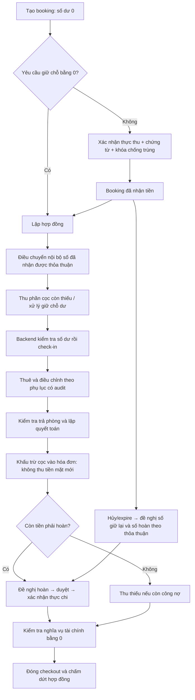

Báo cáo Prompt 03 — tiền giữ chỗ, tiền cọc, khấu trừ và hoàn cọc

Ngày thực hiện: 31/10/2026. Phạm vi: sửa trực tiếp dự án hiện có. Các thay đổi có sẵn của Prompt 01/02 và các phần khác được giữ lại; không commit, push, merge hay chạy migration trên database ứng dụng/production.

1. Hiện trạng trước sửa

`rental_bookings` đã liên kết được với `contracts`. V17 đã có `tenant_deposits`, `deposit_transactions`, kỳ kế toán và financial audit. Tuy nhiên, V18 tạo hợp đồng mới không tạo sổ cọc tương ứng và không chuyển tiền giữ chỗ vào sổ cọc. Các bảng thanh toán hóa đơn đang yêu cầu `invoice_id`; vì vậy không tạo hóa đơn tiền thuê giả để nhận tiền cọc. Thay vào đó mở rộng chính sổ cọc hiện có và dùng chung quyền kế toán, khóa theo chủ sở hữu, kỳ kế toán, audit, thông báo và cơ chế chống trùng của dự án.

2. Các lỗi xác nhận từ mã nguồn

| Nơi xử lý trước sửa | Bằng chứng / hậu quả |
|---|---|
| `RentalLifecycleServiceImpl.changeBookingStatus` và `RentalLifecycleRepository.changeBooking` | Chuyển `RESERVED → DEPOSITED` và gán `deposit_status=PAID` mà không cần giao dịch thu. |
| `RentalLifecycleRepository.createContract` | Chỉ tạo hợp đồng và gán booking; không tạo tài khoản cọc, không có bút toán điều chuyển. |
| `RentalLifecycleServiceImpl.completeCheckin` | Tin cờ `depositVerified` gửi từ frontend, không kiểm tra tiền thực nhận. |
| `RentalLifecycleServiceImpl.completeCheckout` | Dùng `contracts.deposit_amount` thay số dư thực giữ. |
| `RentalLifecycleRepository.settleCheckout/finishCheckout` | Đánh dấu hoàn tất và chấm dứt hợp đồng ngay; không có chứng từ hoàn, phân bổ bù trừ vào hóa đơn hay kiểm tra thu thiếu. |
| `AccountantPortalServiceImpl.deposit` | Thu/khấu trừ/hoàn bằng thao tác số dư, không có khóa chống gửi lại, phương thức, chứng từ hay đề nghị hoàn được duyệt. |
| Đường `DEDUCT` cũ | Trừ sổ cọc nhưng không phân bổ vào hóa đơn, công nợ không giảm tương ứng. |
| `AccountantPortalRepository.books` | Chưa đưa thu/hoàn cọc thực tế vào sổ quỹ/ngân hàng. |
| `AdminTenantServiceImpl.moveOut` | Cho phép đóng hợp đồng qua màn hình người thuê mà bỏ qua quyết toán. |
| `AdminTenantRepository.financial` | Cộng cọc thỏa thuận để hiển thị `deposit_held`, thay vì số dư cọc thực tế. |

Không kết luận có lỗi cộng cọc thành 3.500.000 từ ví dụ 500.000/3.000.000 trong code cũ: phần được đọc không cộng hai số đó; lỗi thực tế là thiếu sổ và điều chuyển tài chính. Cũng không kết luận khoản cọc cũ đã tự được tính vào doanh thu thuê: trước sửa nó đã có bảng riêng. Vấn đề kế toán được sửa là thiếu thu/chi cọc trong sổ tiền và thiếu phân bổ công nợ khi khấu trừ. Các endpoint hợp đồng người thuê đã kiểm tra sở hữu; không tìm thấy căn cứ để khẳng định chúng làm lộ cọc người khác.

3. Nguyên nhân gốc

Trạng thái vận hành, tiền thỏa thuận và tiền đã nhận chưa được tách rõ. Booking dùng status thay chứng từ; checkout dùng mức cọc hợp đồng thay sổ giao dịch. Hai module vòng đời thuê và kế toán có mô hình riêng nhưng không cùng ghi một nghiệp vụ nguyên tử. Luồng trả phòng cũng chưa phân biệt bàn giao vật lý với hoàn tất tài chính.

4. Quy tắc sau sửa

| Nghiệp vụ | Quy tắc mới |
|---|---|
| Tạo booking | Chỉ ghi nghĩa vụ dự kiến, số dư bằng 0. Khóa phòng và kiểm tra cam kết booking/hợp đồng còn hiệu lực. |
| Xác nhận đã thu | Giao dịch `COLLECT` có số tiền, phương thức, thời gian, người ghi nhận, chứng từ và idempotency key. Không được đổi `DEPOSITED` bằng endpoint status. |
| Chuyển khoản | Phải có mã ngân hàng và xác nhận đã đối soát thủ công; ảnh chứng từ không tự xác nhận tiền. Mã đã ghi trong cọc không được dùng lại cho hóa đơn và ngược lại. |
| Chuyển giữ chỗ sang cọc | Cặp `TRANSFER_OUT/TRANSFER_IN`, giữ liên kết nguồn/đích; không có phương thức tiền mặt, không tạo thu mới. `reservationTransferAmount` cho phép ghi rõ số được hai bên thống nhất chuyển. |
| Giữ chỗ lớn hơn cọc | Phải chỉ rõ số chuyển phù hợp. Phần dư tiếp tục nằm ở sổ booking; tạo đề nghị xử lý/hoàn riêng, không làm mất tiền. Chặn check-in khi phần dư chưa xử lý. |
| Thu bổ sung | Chỉ thu phần còn thiếu, không đổi cọc thỏa thuận. Số dư phải khớp tổng giao dịch đã xác nhận. |
| Check-in | Kiểm tra lại trạng thái hợp đồng và số dư đã nhận. Không có chính sách ngoại lệ thiếu cọc thì không tự cho qua. |
| Điều chỉnh cọc | Cần phụ lục, lý do, người duyệt và audit; đổi đồng thời cọc hợp đồng và yêu cầu ở sổ cọc. Giảm dưới số đang giữ tạo đề nghị hoàn chênh lệch, chưa ghi thực chi. |
| Chuyển giữa hợp đồng | Chỉ cùng người thuê, cùng chủ sở hữu, đúng phạm vi quyền, không có khoản hoàn đang chờ hoặc công nợ nguồn; cần phụ lục, đồng thời giảm yêu cầu cọc nguồn theo thỏa thuận. |
| Hủy/expire booking chưa thu | Không sinh giao dịch hoàn giả; giải phóng phòng chỉ khi không còn cam kết khác. |
| Hủy đã thu | Người có quyền đề nghị số hoàn và số giữ lại theo điều khoản; chủ nhà/quản lý duyệt; kế toán/người có quyền ghi thực chi. Không có mức phạt cố định. |
| Quyết toán | Dùng số dư cọc thực tế; khóa hóa đơn, chặn hóa đơn nháp/công nợ lịch sử có dấu hiệu cộng dồn. Phí quyết toán có hóa đơn và dòng chi tiết. |
| Khấu trừ | Ghi `DEDUCT` và `deposit_invoice_allocations`, giảm số dư cọc và dư nợ cùng transaction. Không tạo `payments` tiền mặt. |
| Hoàn tiền | `REQUESTED → APPROVED → PARTIAL/PAID`. Chỉ giao dịch `REFUND` thực chi giảm số dư. Mọi đề nghị đang chờ chiếm dụng phần số dư tương ứng. |
| Đóng hồ sơ | Bàn giao đưa checkout về `SETTLEMENT`, hợp đồng `SETTLING`, phòng sang vệ sinh/bảo trì. Chỉ đóng qua `close-checkout` khi số dư cọc, khoản hoàn chờ và công nợ đều bằng 0. |
| Kỳ khóa | Dùng locking read để thấy trạng thái đóng kỳ mới nhất; kiểm tra kỳ chứng từ và kỳ hiện tại. Không sửa hoặc xóa chứng từ đã xác nhận. |
| Phân quyền | Owner theo sở hữu, Manager theo phân công, Accountant theo hồ sơ/quyền/phân công, Tenant chỉ đọc của mình. Cache frontend phân theo tài khoản và vai trò. |

Sổ cọc có các số tách biệt: yêu cầu thỏa thuận, thu trực tiếp, nhận điều chuyển, tổng nhận hợp lệ, số dư đang giữ, còn thiếu, đang chờ hoàn, thực hoàn và khấu trừ. Khoản đã chuyển/đã đóng không bị hiển thị trở lại thành nghĩa vụ phải thu cọc.

5. Luồng nghiệp vụ



Việc bàn giao phòng và chuyển phòng sang vệ sinh/bảo trì nằm trong cùng hồ sơ checkout nhưng có thể xảy ra trước lúc đóng tài chính. `refund_amount` là số phải hoàn của quyết toán; số đã chi phải đọc từ giao dịch/refund request.

6. File thực hiện trong lượt này

Backend mới:

- `src/main/java/com/thangit/boardinghouse/service/DepositLedgerService.java`
- `src/main/java/com/thangit/boardinghouse/controller/DepositLedgerController.java`
- Migration V22 và hai test mới liệt kê bên dưới.

Backend sửa (đều dưới `boarding-house-backend`):

- `service/impl/RentalLifecycleServiceImpl.java`, `repository/RentalLifecycleRepository.java`
- `dto/request/lifecycle/RentalLifecycleRequests.java`, `controller/RentalLifecycleController.java`
- `service/impl/AccountantPortalServiceImpl.java`, `repository/AccountantPortalRepository.java`
- `repository/AdminInvoiceRepository.java`
- `service/impl/AdminTenantServiceImpl.java`, `repository/AdminTenantRepository.java`
- `service/impl/TenantContractServiceImpl.java`
- `src/test/java/com/thangit/boardinghouse/service/RentalLifecycleServiceImplTest.java`
- `src/test/java/com/thangit/boardinghouse/service/AdminTenantServiceImplTest.java`

Các đường `service`, `repository`, `controller`, `dto` ở trên thuộc `src/main/java/com/thangit/boardinghouse/`. Đường sửa số dư cọc cũ đã được gỡ khỏi repository; endpoint giao dịch cọc cũ trả `DEPOSIT_LEDGER_REQUIRED` để không nhận chứng từ thiếu dữ kiện.

Frontend (dưới `boarding-house-frontend/src`):

- Mới: `components/shared/deposit-ledger-panel.tsx`.
- `components/admin/lifecycle/rental-lifecycle-page.tsx`.
- `components/accountant/accountant-pages.tsx`.
- `components/tenant/contracts/contract-detail-page.tsx`, `contract-list-page.tsx`.
- `components/admin/contracts/contract-status-badge.tsx`, `contract-list-page.tsx`.
- `hooks/use-rental-lifecycle.ts`, `services/rental-lifecycle.service.ts`.
- `types/tenant-contract.ts`, `types/admin-contract.ts`, `constants/contract-status.ts`, `lib/format.ts`.

Giữ theme, shell, sidebar, header và route hiện tại. Bổ sung sổ cọc ngay ở màn hình vòng đời thuê, kế toán và chi tiết hợp đồng Tenant; bổ sung nhãn trạng thái đang quyết toán.

7. Migration

`boarding-house-backend/src/main/resources/db/migration/V22__Unify_reservation_and_security_deposit_ledger.sql`:

- Mở rộng tài khoản cọc cho booking và hợp đồng; thêm khóa ngoại, unique key và trạng thái đối soát.
- Mở rộng giao dịch sẵn có: trạng thái, phương thức, chứng từ, khóa chống trùng, fingerprint, mã ngân hàng, tài khoản liên quan và checkout/refund liên quan.
- Thêm `deposit_refund_requests` và `deposit_invoice_allocations`; không tạo thêm hệ thống thanh toán hóa đơn độc lập.
- Thêm `rental_checkouts.financial_status`; hồ sơ `COMPLETED` cũ được đánh dấu `NEEDS_REVIEW` về tài chính.
- Thêm `invoices.invoice_kind`, giữ duy nhất theo hợp đồng/kỳ/loại. Hóa đơn thuê thường kỳ vẫn duy nhất; hóa đơn `SETTLEMENT` được lưu riêng.
- Thêm view `deposit_balance_anomalies` phục vụ đối soát.
- Hợp đồng lịch sử có cọc thỏa thuận dương hoặc tài khoản/giao dịch chưa đủ căn cứ được đánh dấu cần đối soát. Không dùng số cọc hợp đồng để tự tạo receipt hoặc số dư đã thu. Số dư và giao dịch cũ được giữ nguyên để rà soát.

Đã kiểm tra V1–V21 trên schema mới, chèn dữ liệu hợp đồng/sổ cọc lịch sử trước V22 rồi nâng lên V22 bằng Flyway thật. Không sửa V1–V21 và không chạy V22 lên database ứng dụng.

8. Test bổ sung

`DepositLedgerMysqlTest`: 35 ca tích hợp trên MySQL 8.0.46 thật, dùng JDBC repositories thật và `TransactionTemplate`. Test hai kế toán chạy bằng hai luồng/kết nối riêng; kiểm tra rollback thực tế. Mỗi lần chạy tạo schema mới `prompt03_test_<uuid>` trên localhost, không mở schema ứng dụng và không xóa schema sau test.

`DepositLedgerControllerTest`: 4 ca HTTP/validation (thiếu header, số âm, sai số lẻ, cấu trúc ApiEnvelope). Đây là test contract HTTP; không thay thế kiểm thử security filter qua trình duyệt.

`AdminTenantServiceImplTest`: thêm ca chặn đóng hợp đồng tắt qua màn hình người thuê. `RentalLifecycleServiceImplTest`: dùng số dư/debt từ sổ cọc trong ca quyết toán thay cọc thỏa thuận.

9. Kết quả thực tế

| Test bắt buộc | Kết quả MySQL |
|---|---|
| TC01: booking có giữ chỗ, chưa thanh toán | PASS |
| TC02: không tự đổi DEPOSITED | PASS |
| TC03: thu thành công, có chứng từ | PASS |
| TC04: gửi lại cùng giao dịch chỉ ghi một lần | PASS |
| TC05: giữ phòng không yêu cầu tiền | PASS |
| TC06: chuyển 500.000 vào cọc 3.000.000, còn 2.500.000 | PASS |
| TC07: không chuyển booking hai lần | PASS |
| TC08: thu bổ sung không đổi cọc thỏa thuận | PASS |
| TC09: check-in thiếu cọc bị chặn dù checkbox đúng | PASS |
| TC10: hủy chưa thu không sinh hoàn tiền | PASS |
| TC11: hủy và hoàn đủ 500.000 | PASS |
| TC12: giữ lại 200.000, thực hoàn 300.000 | PASS |
| TC13: không đề nghị hoàn vượt số dư | PASS |
| TC14: hai kế toán hoàn đồng thời, chỉ một thành công | PASS |
| TC15: thu cọc không sinh payment tiền thuê | PASS |
| TC16: điều chuyển không sinh thu lần hai | PASS |
| TC17: 3.000.000 − 1.000.000 − 400.000 = 1.600.000 | PASS |
| TC18: phân bổ khấu trừ giảm đúng công nợ, không sinh tiền mặt | PASS |
| TC19: còn khoản hoàn thì không đóng tài chính | PASS |
| TC20: hoàn một phần, gửi lại và hoàn đủ, đóng đúng hồ sơ | PASS |
| TC21: lỗi trong transaction làm rollback | PASS; có thêm ca lỗi sau ghi hoàn tiền |
| TC22: kiểm tra vai trò, từ chối đọc sổ người khác | PASS ở service; thêm ca đọc sổ chính mình với BIGINT UNSIGNED |
| TC23: kỳ đã khóa chặn ghi sổ | PASS |
| TC24: số dư kế toán khớp ledger và view đối soát | PASS |
| TC25: dữ liệu cũ không mất và không tự thành thực thu | PASS; thêm ca ledger cũ thiếu chứng từ bị chặn |

Các ca thêm: chuyển khoản chưa đối soát; số dư bị sửa ngoài ledger; phụ lục giảm cọc tạo hoàn chênh lệch; chuyển giữa hợp đồng có chống trùng; giữ chỗ dư vẫn bảo toàn; rollback sau hoàn; sổ quỹ chỉ tính dòng tiền thật; mã ngân hàng không dùng lại giữa cọc và tiền thuê.

| Nhóm kiểm tra | Kết quả |
|---|---|
| Toàn bộ backend | 120 tests, 0 failures, 0 errors, 0 skipped |
| MySQL deposit lifecycle | 35/35 PASS |
| HTTP contract/validation mới | 4/4 PASS |
| AccountantPortalServiceImplTest | 17/17 PASS |
| TenantInvoicePaymentServiceImplTest | 3/3 PASS |
| AdminInvoiceServiceImplTest | 1/1 PASS |
| TenantContractServiceImplTest | 3/3 PASS |
| RentalLifecycleServiceImplTest | 4/4 PASS |
| AdminTenantServiceImplTest | 4/4 PASS |
| Backend compile | PASS trong Maven test và lần compile riêng |
| Frontend TypeScript | PASS (`tsc --noEmit --incremental false`) |
| Frontend lint | PASS |
| Frontend production build | PASS, 104 trang prerender |
| `git diff --check` | PASS; Git có thông báo quy ước LF/CRLF |

Lệnh tái chạy từ `boarding-house-backend`, với MySQL kiểm thử riêng đã khởi động trên cổng 33307:

```powershell
.\mvnw.cmd -q '-Dprompt03.mysql=true' '-Dprompt03.mysql.port=33307' '-Dprompt03.mysql.user=root' '-Dprompt03.mysql.password=' test
```

Test mặc định không bật `prompt03.mysql=true` sẽ bỏ qua bộ MySQL có chủ đích. Tài khoản trong `.env` không có quyền tạo schema mới; lần thử ban đầu vì vậy bị từ chối. Sau đó dùng MySQL riêng trên `127.0.0.1:33307`, dữ liệu tại `D:\DATN\prompt03-mysql-test-data`. Dữ liệu test được giữ lại, tiến trình helper được dừng khi hoàn tất. Không cần nâng quyền tài khoản database ứng dụng.

10. Dữ liệu cần đối soát

Dùng `deposit_balance_anomalies`, các tài khoản `NEEDS_REVIEW`, booking đã đánh dấu nhận tiền cũ, giao dịch cọc cũ thiếu phương thức/chứng từ, và checkout cũ `financial_status=NEEDS_REVIEW`. Đối chiếu biên lai, sao kê, phiếu chi và lịch sử khấu trừ trước khi quyết định bút toán chuyển đổi. Không tự đổi toàn bộ dữ liệu lịch sử sang VERIFIED và không tạo COLLECT để che chênh lệch. Công nợ trong `invoice_debt_carryover_anomalies` phải được xử lý trước khi cho bù trừ.

11. Giới hạn kiểm chứng và vận hành

Chưa chạy migration trên bản sao dữ liệu production, chưa UAT qua trình duyệt với tài khoản thật và chưa kiểm thử toàn bộ security filter/JWT bằng HTTP end-to-end. Không kết nối ngân hàng thật: hệ thống ghi xác nhận thực thu/thực chi có chứng từ do người có quyền nhập, không tự thực hiện lệnh chuyển tiền. Chưa có công cụ tự phê duyệt/đối soát dữ liệu cũ; hồ sơ thiếu chứng cứ bị chặn để người phụ trách rà soát theo quy trình kiểm toán. Không bật ngoại lệ nhận phòng thiếu cọc khi chưa có chính sách được phê duyệt. Điện nước và bồi thường cuối kỳ vẫn phải được người vận hành chốt thành khoản phí hợp lệ trong hồ sơ hiện có; lượt này không thay chính sách tính đơn giá hay kỳ hóa đơn.

12. Việc tiếp tục ở Prompt 04

Kiểm thử sâu lịch đặt phòng giao nhau, tạo booking đồng thời, sửa trạng thái phòng từ module khác, sửa/gia hạn thời gian giữ chỗ, tác vụ expire theo chính sách, giữ chỗ quá hạn nhưng còn nghĩa vụ tiền, và đặt lại phòng trong khi hồ sơ tài chính cũ đang quyết toán. Kiểm tra deadlock/retry giữa toàn bộ module cùng giữ khóa người sở hữu/phòng/hợp đồng/hóa đơn, ngoài ca hai kế toán hoàn tiền đã được kiểm chứng. UAT cùng chủ nhà/quản lý/kế toán/người thuê và thử migration trên bản sao dữ liệu có đối soát trước khi triển khai.

API bổ sung dùng các base `/api/admin/deposit-ledger`, `/api/accountant/deposit-ledger`, `/api/tenant/deposit-ledger`. `GET /` và `GET /{id}` đọc theo phạm vi. Các thao tác ghi gồm `/{id}/collections`, `/{id}/refunds`, `/{id}/refunds/{requestId}/approve`, `/{id}/refunds/{requestId}/payments`, `/{id}/requirement`, `/{id}/transfers`, `/{id}/close-checkout`. Thu, thực chi và điều chuyển hợp đồng yêu cầu header `Idempotency-Key`. Tenant chỉ được đọc dù cố gọi URL ghi.
