# Tạo hợp đồng trực tiếp – SmartHome AI

Ngày thực hiện: 02/11/2026. Không triển khai hoặc thay đổi database ứng dụng/production. Các migration và dữ liệu tổng hợp phục vụ test chỉ chạy trong schema UUID tại MySQL thử nghiệm localhost:33307.

## Kiến trúc và nghiệp vụ

Trước thay đổi, `AdminContractController` chỉ có API đọc/xuất và gia hạn; việc lập hợp đồng nằm trong `RentalLifecycleServiceImpl.createContract`, bắt buộc booking hợp lệ, tài khoản thuê và kiểm tra cọc giữ chỗ. `RoomLifecycleGuard.checkin` bắt buộc đúng một booking. Vì vậy chỉ thêm nút giao diện sẽ không tạo được luồng trực tiếp đúng nghiệp vụ.

Luồng mới tái sử dụng bảng `contracts`, `tenant_profiles`, `tenant_residences`, `contract_utility_rates`, `contract_services`, `contract_terms`, `contract_versions`, `tenant_deposits` và cơ chế xác nhận/bàn giao hiện tại. Mô hình thực tế dùng `tenant_residences` cho liên kết người ở; không tạo thêm bảng `contract_tenants` hoặc bảng cọc song song.

```mermaid
flowchart LR
  A[Chọn phòng và hồ sơ / khách mới] --> B[DRAFT]
  B --> C[Sửa nháp / tạo tài khoản người thuê]
  C --> D[Kiểm tra lại quyền, phòng và lịch thuê]
  D --> E[PENDING_CONFIRMATION]
  E --> F[Xác minh danh tính và xác nhận nội dung hai bên]
  F --> G[Thu cọc theo chứng từ và nghĩa vụ đầu kỳ nếu có]
  G --> H[Biên bản bàn giao và xác nhận người thuê]
  H --> I[Check-in hợp lệ: ACTIVE và OCCUPIED]
```



- Bản nháp không giữ phòng, không kích hoạt cư trú, không lập booking, hóa đơn hoặc giao dịch thanh toán. Nhiều nháp có thể cùng chọn phòng, nhưng chỉ một nháp có thể chuyển sang hợp đồng cam kết khi phòng còn đủ điều kiện.
- Khi gửi xác nhận, yêu cầu tài khoản TENANT hoạt động. Chỉ tạo một nghĩa vụ cọc trong sổ hiện có với số dư thực thu 0. Gửi lặp không tạo thêm nghĩa vụ hoặc chứng từ thu.
- Giá thuê được snapshot từ phòng hoặc thỏa thuận; đơn giá điện/nước, dịch vụ và điều khoản dùng `ContractOnboardingService.initialize` như luồng booking. Không lấy giá phòng mới để thay hợp đồng cũ.
- Hai bên vẫn phải xác nhận phiên bản nội dung và biên bản; tạo/gửi hợp đồng không đồng nghĩa ký hoặc đã nhận phòng.
- Hợp đồng hiện dùng khoảng thời gian hữu hạn `[start,end)` và chu kỳ hàng tháng. Không giả lập hợp đồng vô thời hạn bằng ngày kết thúc xa trong tương lai; không cung cấp chu kỳ chưa được pipeline hóa đơn hỗ trợ.

## Phân quyền, giao dịch và chống trùng

OWNER thao tác trong nhà sở hữu. MANAGER cần phân công hiện hành và capability `CONTRACT_APPROVE` để tạo/sửa/gửi nháp. Các bản ghi được đọc từ cùng bảng hợp đồng theo phạm vi hiện có; ACCOUNTANT/TECHNICIAN/TENANT không được lập hợp đồng.

Hồ sơ chọn sẵn phải thuộc đúng nhà trọ và còn trong phạm vi actor. Khách mới chỉ cần tên, điện thoại; email, CCCD, địa chỉ, ngày sinh và liên hệ khẩn cấp tùy chọn khi lập nháp. Kiểm tra trùng điện thoại gồm dạng `0...` và `+84...`, email và số giấy tờ. Tạo hồ sơ mới và nháp cùng transaction; lỗi giữa quá trình sẽ rollback toàn bộ. Hồ sơ có liên kết nhà trọ nhưng chưa có phòng không được tính là cư trú thực tế.

`Idempotency-Key` bắt buộc cho POST tạo mới. Bảng `contract_creation_requests` giữ `(actor_id,request_key,request_hash,contract_id)`. Khóa phòng trước, sau đó khóa actor trong transaction (cùng thứ tự phòng trước như booking để tránh đảo khóa qua FK created_by), kiểm tra scope trước replay; cùng key/cùng nội dung trả cùng hợp đồng, khác nội dung bị từ chối. Khóa phòng dùng chung `RoomLifecycleGuard` bảo vệ cả booking và luồng trực tiếp. Khi gửi nháp kiểm tra lại lịch, booking, bảo trì, hợp đồng/cư trú chưa bàn giao; không dựa riêng trạng thái phòng từ trình duyệt.

Sửa nháp dùng `onboarding_version`; phiên bản cũ bị từ chối. Giữ nguyên phòng/người thuê của nháp đã lưu; có thể sửa thời hạn, giá, cọc, dịch vụ, điều khoản, ngày dự kiến nhận phòng và ghi chú. Muốn đổi các bên/phòng thì lập nháp mới. Ghi chú/ngày nhận phòng của hợp đồng trực tiếp cũng được đưa vào snapshot để kiểm tra revision. Không thay định dạng snapshot booking cũ.

## Người đã ở nhưng chưa số hóa hợp đồng

Cho phép chọn phòng OCCUPIED chỉ khi có đúng một cư trú ACTIVE đúng người thuê, chưa liên kết hợp đồng và không có hợp đồng vận hành/booking xung đột hoặc bảo trì chưa hoàn tất. Bản nháp lưu nguồn `legacy_residence_id`; khi gửi xác nhận phải kiểm tra lại đúng nguồn, rồi liên kết cư trú hiện hữu với hợp đồng. Không tự tạo người ở khác hoặc đổi ngày vào ở cũ.

Phòng đã có hợp đồng, khác người thuê hoặc có nhiều cư trú chưa đối soát sẽ bị từ chối và yêu cầu đối soát riêng. Không suy luận tiền cọc/tiền thuê lịch sử đã thu. Luồng số hóa vẫn yêu cầu xác minh, hai bên xác nhận và biên bản bàn giao trước khi hợp đồng ACTIVE; không cho chuyển trạng thái bằng checkbox đơn thuần.

## API

| Method | Endpoint dưới `/api/admin/contracts` | Mục đích |
|---|---|---|
| GET | `/creation-options?propertyId=&keyword=` | Nhà được cấp quyền, phòng, tìm người thuê và dịch vụ đã cấu hình trong thỏa thuận của nhà |
| POST | `/` | Tạo nháp hoặc tạo và gửi xác nhận; header `Idempotency-Key` |
| GET | `/{id}/draft` | Đọc nháp trực tiếp và phiên bản để sửa |
| PUT | `/{id}/draft?version=` | Sửa nháp có kiểm tra phiên bản; body như tạo mới, giữ phòng/người thuê |
| POST | `/{id}/submit` | Gửi bản nháp sang chờ xác nhận |

Body tạo gồm `roomId`, một trong `tenantProfileId` hoặc `newTenant`, `terms` (DTO CreateContract hiện có), `expectedCheckinDate`, `note`, `submit`. Điểm cuối tạo từ booking, API onboarding và API check-in hiện hữu giữ nguyên. Check-in chỉ bỏ yêu cầu booking đối với nguồn DIRECT do backend ghi; không bỏ kiểm tra hợp đồng/phòng, xác nhận hay chứng cứ.

## Giao diện

- Nút Plus “Thêm hợp đồng” cạnh “Xuất danh sách” tại `/admin/contracts`.
- Trang `/admin/contracts/new` có breadcrumb, bốn bước, tìm người thuê debounce, thêm hồ sơ nhanh, phòng phụ thuộc nhà, tự điền giá phòng, biểu mẫu điều khoản và dịch vụ, bản xem lại và tóm tắt bên cạnh trên desktop.
- Dữ liệu giữ trong state khi chuyển bước. Kiểm tra trường theo từng bước, loading/error, chặn gửi khi đang lưu và giữ idempotency key khi retry cùng payload.
- Cảnh báo đóng/tải lại trang và điều hướng bằng liên kết khi còn dữ liệu chưa lưu. Không lưu PII của biểu mẫu vào localStorage. Browser history navigation do router quản lý; trước khi rời biểu mẫu nên dùng Lưu nháp để bảo đảm phục hồi.
- Sau lưu thành công chuyển chi tiết hợp đồng, có thông báo thành công. Nháp có nút sửa tại `/{id}/edit`, mở hồ sơ/tài khoản người thuê và gửi xác nhận. Mutation invalidate dữ liệu dùng chung hiện có.
- Tổng cần thu là tạm tính một tháng thuê + cọc + dịch vụ/định mức với một người, chưa gồm công tơ. Số chính thức theo hóa đơn/sổ cọc. Chỉ số công tơ và chứng cứ được ghi tại nhận phòng, không giả lập bàn giao trong wizard.

## Migration và triển khai

V30 cho phép `contracts.tenant_id` NULL ở DRAFT, thêm `creation_source` (mặc định BOOKING cho bản ghi cũ), `expected_checkin_date`, `note`, `legacy_residence_id` và bảng idempotency. Constraint ngăn hợp đồng không có tài khoản chuyển sang trạng thái vận hành. Không sửa V1–V29, không đổi owner, không tự phân công, không xóa dữ liệu hay tự chuyển dữ liệu demo.

Trước triển khai: sao lưu, chạy Flyway V30 trên bản sao database và xác minh dữ liệu/constraint, sau đó triển khai backend và frontend tương ứng theo quy trình vận hành. Database ứng dụng đang thiếu migration trước đó phải nâng đúng thứ tự bằng Flyway; không chạy riêng SQL để bỏ qua lịch sử. Chưa chạy migration ứng dụng trong công việc này.

## Kiểm thử

Kiểm thử MySQL dùng `-Ddirect.mysql=true` và fixture schema UUID riêng, gồm Owner/Manager, scope khác nhà, phòng không hợp lệ, overlap, concurrency Owner–Manager, snapshot, nháp không cư trú, khách mới không tài khoản, sửa/version, rollback, gửi lặp, số hóa cư trú, từ chối thay thế người đang ở và check-in đầy đủ không booking.

Controller tests kiểm tra header bắt buộc, giá âm, rate null, điện thoại sai và route tạo hợp lệ. Bộ hồi quy toàn phần chạy thêm tests Prompt 03–11, sync Owner/Manager để kiểm tra booking, tiền cọc, hóa đơn, xác nhận, nhận/trả phòng và bảo mật không bị ảnh hưởng.

Kết quả:

- Bộ hồi quy toàn phần: **499 tests, 0 failures/errors/skipped**, exit 0. Log `D:/DATN/direct-contract-all-tests.log`.
- Sau mở rộng kiểm thử và hoàn thiện mã: **19/19 MySQL tests mới và 5/5 controller tests**, exit 0. Có ca booking và tạo trực tiếp cạnh tranh cùng phòng, hai actor Owner/Manager cạnh tranh, rollback, alias điện thoại, submit lặp và nhận phòng đầy đủ không booking. Log `D:/DATN/direct-contract-final-tests.log`.
- `mvnw.cmd -q -DskipTests package`: exit 0 sau khi test đạt; tạo JAR thực thi. Log `D:/DATN/direct-contract-package.log`.
- Frontend ESLint, TypeScript và production build đều đạt. Build có routes `/admin/contracts/new` và `/admin/contracts/[contractId]/edit`. Logs `D:/DATN/direct-contract-lint.log`, `direct-contract-typecheck.log`, `direct-contract-build.log`.
- Không kiểm thử giao diện bằng trình duyệt trong đợt này. Không triển khai hoặc nâng database ứng dụng. Các JSON evidence của bộ QA cũ sinh lại khi chạy acceptance đã được trả về bản ban đầu; log và surefire reports mới giữ kết quả đợt này.

Lệnh test riêng (thư mục backend, MySQL thử nghiệm cổng 33307 đang hoạt động):

```powershell
.\mvnw.cmd -q '-Ddirect.mysql=true' '-Dprompt03.mysql.port=33307' '-Dprompt03.mysql.user=root' '-Dprompt03.mysql.password=' '-Dtest=DirectContractMysqlTest,DirectContractControllerTest' test
```

Frontend: `npm.cmd run lint`, `npx.cmd tsc --noEmit --incremental false`, `npm.cmd run build`. Không thêm dependency.

## Tệp ảnh hưởng

Backend: `AdminContractController`, `AdminContractRepository`, `DirectContractService` mới, `RoomLifecycleGuard`, `ContractOnboardingService`, DTO `RentalLifecycleRequests`, migration V30, `DirectContractMysqlTest`, `DirectContractControllerTest`.

Frontend: service `direct-contract.service.ts` mới; component `contract-create-page.tsx`, `direct-contract-draft-panel.tsx`; nút tạo ở `contract-list-page.tsx`, thông báo và thao tác nháp ở `contract-detail-page.tsx`; routes `contracts/new` và `contracts/[contractId]/edit`.

## Xử lý lỗi tải dữ liệu trên môi trường local (02/11/2026)

Đã xác minh tiến trình cũ ở cổng 8080 chưa có `/api/admin/contracts/creation-options` trong OpenAPI, trong khi frontend mới đã gọi API này. Schema local ở V27. API cũ còn có thể diễn giải `creation-options` là `{contractId}` rồi trả 400, không phải lỗi mạng.

Đã thêm phân loại lỗi 400/404 cho phiên bản API chưa phù hợp, giữ thông báo lỗi phân quyền từ server và phân biệt backend offline. Bốn kiểm thử hồi quy thông báo lỗi đạt. Cấu hình mới cho phép dùng `FLYWAY_USERNAME`/`FLYWAY_PASSWORD` riêng, mặc định dùng đúng datasource hiện tại; không cấp thêm quyền quản trị cho tài khoản runtime.

Đã sao lưu local trước khi khởi động lại: `D:/DATN/boarding-house-before-contract-fix-20261102-030048.sql`. Lần nâng cấp bị MySQL chặn tại trigger đầu tiên của V28: `boarding_app` không có quyền SUPER khi binary logging bật. Không đổi cấu hình binary log hoặc bỏ trigger. Sau khi xác minh toàn bộ cột mới chỉ NULL/0, audit rỗng, các capability mới chỉ là bản sao LEGACY_REVIEW từ phân công gốc và chưa có trigger nào được tạo, phần DDL V28 dở dang đã được hoàn tác. Flyway repair đã xóa bản ghi V28 thất bại; truy vấn xác nhận V27 thành công và các bảng V28 chưa tồn tại. Dữ liệu nghiệp vụ/phân công gốc được giữ nguyên.

Ban đầu backend mới chưa khởi động lại được vì thiếu tài khoản migration có quyền quản trị. Sau khi người dùng cung cấp quyền quản trị local, đã chạy Flyway đúng thứ tự V28–V30 thành công và xác minh đủ 30 migration. Runtime được giữ ở `boarding_app`; tài khoản quản trị chỉ dùng cho Flyway. Đã sửa giá trị mật khẩu Flyway không khớp và bổ sung JWT_SECRET ngẫu nhiên hợp lệ khi phát hiện cấu hình JWT bị thiếu. Không ghi bí mật vào báo cáo hoặc source; người dùng cần đăng nhập lại.

Xác nhận cuối trên môi trường local: backend Java 21 đã chạy ở cổng 8080; `/api/v1/health` trả UP; OpenAPI có `GET /api/admin/contracts/creation-options` và `POST /api/admin/contracts`. Kiểm tra chỉ đọc bằng service thật với phạm vi Owner tải được hai nhà trọ và dữ liệu phòng/người thuê của từng nhà, dùng kết nối `boarding_app`. Không tạo hợp đồng hoặc giao dịch thử trên dữ liệu thật. Log migration: `D:/DATN/backend-contract-migrate.log`; log backend: `D:/DATN/backend-contract-ready-out.log`; log kiểm tra options: `D:/DATN/backend-contract-check.log`.
