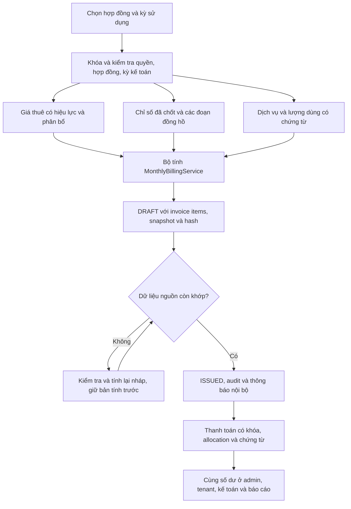

# Prompt 06 — Điện nước, dịch vụ và lập hóa đơn hằng tháng

Thực hiện trên repository hiện có, tiếp nối Prompt 01–05. Không commit/push/merge, triển khai, reset hoặc ghi dữ liệu vào database ứng dụng. Mọi dữ liệu kiểm thử được tạo trong schema UUID mới trên MySQL biệt lập `127.0.0.1:33307`.

## 1. Hiện trạng, lỗi và nguyên nhân

Audit đã được thông báo trước khi sửa. Các vị trí dưới đây là anchor trong mã sau sửa để đối chiếu; không gán số dòng hiện tại thành số dòng của bản cũ.

| Phát hiện trước sửa | Nguyên nhân | Vị trí khắc phục |
| --- | --- | --- |
| Chưa có API ghi/chốt chỉ số theo kỳ có kiểm soát đồng thời | Chủ yếu mới đọc `utility_readings`; thiếu version, chứng từ và revisions | `MonthlyBillingService.record`, `MonthlyBillingController` |
| Chưa tự lấy cuối kỳ trước | Đọc bản ghi rời rạc; thiếu kiểm tra chuỗi | `MonthlyBillingService.previous` |
| Thay đồng hồ sau bàn giao chỉ bị chặn để đối soát | Chưa có chỉ số tháo/lắp và kỳ sử dụng trong sự kiện | `MonthlyBillingService.replace`, `consumption`; V25 mở rộng `utility_meter_events` |
| Kỳ đầu và các kỳ có reset dễ hiển thị tiêu thụ âm | Các màn người thuê/báo cáo trừ trực tiếp current − previous | `TenantUtilityRepository`, `TenantHomeRepository`, `TenantInvoiceRepository`, các mapper và `AdminReportRepository` dùng consumption theo đoạn |
| Giá hợp đồng đã tách từ Prompt 05 nhưng thiếu lịch sử hiệu lực để tính kỳ mới | Chỉ có đơn giá hiện tại trong hợp đồng | `billing_rate_versions`, `MonthlyBillingService.price/rate` |
| Dịch vụ chỉ hỗ trợ phí cố định/theo người ở luồng lập hóa đơn | Thiếu lượng dùng thực, số lượng theo thỏa thuận, ngày ngừng và phân bổ | `MonthlyBillingService.service/usage/stop/calculate` |
| Tiền phòng luôn một tháng | Không có chính sách FULL_MONTH/ACTUAL_DAYS | `MonthlyBillingService.rent/calculate`, `contracts.rent_proration` |
| Phát hành chỉ đổi trạng thái | Chưa kiểm tra lại dữ liệu/bản tính; cổng kế toán có đường phát hành riêng | `AdminInvoiceRepository.validateIssue`; cả hai cổng dùng chung bước này |
| Bản nháp thiếu quy trình tính lại và lưu bản tính trước | Chỉ có tạo/issue/adjust tổng tiền | `AdminInvoiceService.recalculate`, `invoice_calculation_revisions` |
| Bulk preview chỉ xem tiền phòng | Không chạy cùng bộ tính điện/nước/dịch vụ | `BillingBatchService.preview` |
| Lỗi một phòng có thể hủy cả batch | Transaction bao toàn bộ bulk | `BillingBatchService.generate`: REQUIRES_NEW từng hợp đồng |
| Chưa có job thực thi cấu hình tạo hóa đơn | Có `billing_settings.auto_generate_invoices` nhưng không có scheduler tương ứng | `MonthlyBillingScheduler`, `BillingBatchService.scheduled` |
| Mã hóa đơn dễ va chạm khi tạo nhanh | Dùng `nanoTime % 10000` với mã phòng có thể trùng giữa các nhà | UUID trong mã hóa đơn; unique database vẫn giữ |
| Hủy hóa đơn rồi lập lại bị unique key cũ chặn | Unique bao gồm cả hóa đơn CANCELLED | V25 dùng unique nghĩa vụ đang hiệu lực; hóa đơn hủy được giữ nguyên |
| Thanh toán có thể trừ hai lần khi tính số dư | MySQL đánh giá SET từ trái sang phải: biểu thức sau đọc cột vừa cập nhật | Sửa thứ tự SET và dùng remaining cũ một lần trong `AdminInvoiceRepository.applyPayment`, `AccountantPortalRepository.applyPayment/reverseInvoice` |
| Điều chỉnh tổng tiền có thể xét trạng thái từ số dư đã sửa | Cùng lỗi thứ tự SET | `AdminInvoiceRepository.adjust` |
| PENDING_REVIEW có thể thành nợ/thanh toán trước phát hành | Một số truy vấn chỉ loại DRAFT/CANCELLED | Đồng bộ bộ lọc nợ/báo cáo và chặn nhận tiền cho PENDING_REVIEW |
| Quyết toán có nguy cơ thu lại điện/nước đã lập hóa đơn | Khoản UTILITY do người dùng nhập chưa đối chiếu hóa đơn kỳ | `MonthlyBillingService.validateSettlement`, nối vào completeCheckout |
| Chi tiết hóa đơn tenant lỗi khi dùng JDBC thật | `query(Map.class)` cố tạo instance của interface Map; mapper ngày chỉ nhận LocalDate trong khi JDBC trả SQL Date | `TenantInvoiceRepository.invoice` dùng ColumnMapRowMapper; `TenantInvoiceServiceImpl.date` chuyển đúng kiểu ngày; bắt được bằng E2E MySQL |

Đã đọc các đường hóa đơn admin/tenant/kế toán, cấu hình, quản lý phòng, hợp đồng/check-in và migrations. Giá niêm yết trong quản lý phòng tiếp tục là giá niêm yết; không dùng nó để tính lại hợp đồng đã ký. Không thấy cơ chế hợp đồng tham chiếu trực tiếp biểu giá khu trọ có phiên bản; triển khai này dùng thỏa thuận theo hợp đồng, không tự tạo cơ chế tham chiếu giả.

Các vị trí review cụ thể dưới `boarding-house-backend/src/main/java/com/thangit/boardinghouse/`:

| File và dòng hiện tại | Nội dung |
| --- | --- |
| `service/MonthlyBillingService.java:70` | Chuỗi chỉ số kỳ trước/baseline |
| `service/MonthlyBillingService.java:74` | Tính các đoạn đồng hồ |
| `service/MonthlyBillingService.java:81` | Ghi/chốt, version và cảnh báo |
| `service/MonthlyBillingService.java:89` | Sự kiện thay đồng hồ theo kỳ |
| `service/MonthlyBillingService.java:97` | Công thức phân bổ thuê |
| `service/MonthlyBillingService.java:98` | Bộ tính hóa đơn dùng chung |
| `repository/AdminInvoiceRepository.java:28` | Kiểm tra lại trước phát hành |
| `repository/AdminInvoiceRepository.java:95` | Số dư thanh toán admin |
| `repository/AdminInvoiceRepository.java:97` | Điều chỉnh không âm dư nợ |
| `repository/AccountantPortalRepository.java:34` | Phát hành qua cổng kế toán |
| `repository/AccountantPortalRepository.java:45` | Số dư thanh toán kế toán |
| `service/BillingBatchService.java:24` | Preview đầy đủ chi phí |
| `service/BillingBatchService.java:26` | Transaction riêng từng hợp đồng |
| `service/BillingBatchService.java:27` | Scheduler idempotent và run history |
| `repository/TenantInvoiceRepository.java:36` | Mapping Map từ JDBC thật |

## 2. Quy tắc điện nước

- Kỳ lưu bằng ngày đầu tháng; UI chọn tháng sử dụng, tách khỏi ngày thu tiền/phát hành.
- Chỉ ghi cho hợp đồng đã nhận phòng hoặc đang quyết toán, đúng phạm vi, có đồng hồ ACTIVE và baseline bàn giao.
- Kỳ đầu dùng baseline của hợp đồng. Kỳ sau dùng current của **kỳ liền trước đã CONFIRMED**. Thiếu kỳ trước trả `PREVIOUS_READING_REQUIRED`, không suy đoán mức sử dụng bằng 0.
- Không âm, không ghi kỳ tương lai. Ghi nhận phải có chứng từ/tham chiếu và lý do; có actor, thời gian, version, trạng thái và snapshot revisions.
- Không có sự kiện thay hợp lệ: consumption = current − previous, không được âm.
- Có thay: cộng từng đoạn `(chỉ số tháo − đầu đoạn)` và đoạn cuối `(cuối kỳ − chỉ số lắp)`. Giữ mã cũ/mới, chỉ số tháo/lắp, kỳ, lý do, actor và chứng từ. Không trừ trực tiếp chỉ số thuộc hai đồng hồ khác nhau.
- Ví dụ được test: đầu 1.200, tháo 1.350, lắp 0, cuối 40 ⇒ 150 + 40 = **190 kWh**.
- METER dùng consumption đã chốt × đơn giá có hiệu lực; FIXED dùng khoản cố định của hợp đồng và không cộng thêm dòng tiêu thụ. Phí cố định không được reset đồng hồ phòng về 0 khi nhận/trả phòng.
- Tiêu thụ 0 hoặc lớn hơn 3 lần kỳ trước được cảnh báo. Người có quyền phải kiểm tra, xác nhận cảnh báo và ghi lý do. Không gán nhãn gian lận hoặc tự sửa số.
- Hai nhân viên cùng ghi dựa trên version cũ: chỉ một bản ghi thành công; bản ghi còn lại bị conflict.
- Không sửa nguồn kỳ đã phát hành/khóa kế toán. Nếu đã có kỳ sau, chặn sửa kỳ trước để không âm thầm làm lệch chuỗi.
- Sự kiện thay đồng hồ lịch sử thiếu kỳ/chỉ số tháo bị đưa vào đối soát. Sau ACTIVE không dùng endpoint thay đồng hồ sơ bộ của onboarding; phải đi luồng theo kỳ để có đủ các đoạn.

## 3. Giá và hiệu lực

Đơn giá gốc theo hợp đồng được giữ. Thay đổi giá điện/nước/thuê được ghi append-only trong `billing_rate_versions`, kèm ngày hiệu lực, người ghi, căn cứ và lý do. Chọn phiên bản gần nhất không sau đầu kỳ; không nhập sửa giá kỳ quá khứ hoặc kỳ đã phát hành. Thay đổi từ kỳ mới không sửa invoice items cũ.

Phạm vi tự động hiện hỗ trợ đơn giá phẳng METER và phí FIXED. Hiệu lực thay đổi giá là đầu tháng. **Thay giá giữa kỳ, giá bậc thang hoặc chu kỳ chưa có quy tắc phân bổ xác minh không được giả lập bằng giá phẳng**; cần quy trình riêng trước khi tự động áp dụng. METER đã chốt mà giá áp dụng thay đổi phải được kiểm tra/chốt lại; draft cũ không tự theo giá mới khi phát hành.

Không coi thỏa thuận nhập vào là chứng minh một giá điện tùy ý được phép thu. Nguồn chính thức đã kiểm tra gồm [Thông tư 60/2025/TT-BCT trên cổng Bộ Công Thương](https://moit.gov.vn/van-ban-phap-luat/thong-tu-quy-dinh-ve-thuc-hien-gia-ban-dien2.html) và [hướng dẫn giá điện sinh hoạt của Chính phủ](https://xaydungchinhsach.chinhphu.vn/quy-dinh-gia-ban-le-dien-sinh-hoat-119251209090437888.htm). Hướng dẫn nêu cách xác định định mức theo tình trạng thuê/cư trú và giới hạn tổng tiền chủ nhà thu khi người thuê không ký trực tiếp với bên bán điện. Vì vậy không hardcode một mức tiền/kWh thành mức hợp pháp cho mọi cơ sở. UI yêu cầu căn cứ và nhắc người vận hành đối chiếu quy định phù hợp.

Đã kiểm tra thêm [thông tin Bộ Công Thương về dự thảo sửa đổi năm 2026](https://moit.gov.vn/tin-tuc/bo-cong-thuong-lay-y-kien-hoan-thien-du-thao-thong-tu-so-60-2025-tt-bct-de-som-ap-dung-khung-gio-cao-diem-thap-diem-moi.html). Không dùng nội dung dự thảo như quy tắc đã có hiệu lực. Hệ thống chưa tự xác minh hóa đơn điện tổng, định mức cư trú, biểu giá địa phương hay hạn mức tổng thu cho từng cơ sở; đây là giới hạn vận hành phải đối soát trước áp dụng tự động.

## 4. Dịch vụ

| Cách tính | Nguồn số lượng |
| --- | --- |
| FIXED | Một phòng/tháng theo thỏa thuận |
| PER_PERSON | Hồ sơ cư trú liên kết tại cuối khoảng sử dụng, tối thiểu người đại diện |
| QUANTITY | Số lượng khai trong thỏa thuận, ví dụ hai xe; thiếu số lượng bị chặn |
| USAGE | `service_period_usage` theo dịch vụ/kỳ và chứng từ; thiếu không được mặc định 0 |
| ONCE | Chỉ tháng dịch vụ bắt đầu có hiệu lực |

Dịch vụ có mã/tên, đơn vị, đơn giá, ngày hiệu lực/ngừng, trạng thái, số lượng, cờ phân bổ theo ngày và lịch sử cấu hình. Không cho thêm cùng mã với thời gian chồng lấn. Ngày ngừng là cận không bao gồm; phần trước đó vẫn được xét đúng khoảng. Nếu có cờ prorate, phân bổ theo số ngày áp dụng / số ngày tháng; nếu không, áp dụng mức trọn kỳ đã thỏa thuận.

USAGE đã ghi được giữ kèm chứng cứ; không cho ghi đè không kiểm soát. Sửa mức sử dụng đã chốt/đã tính tiền cần quy trình đối soát hoặc điều chỉnh, thay vì xóa chứng từ. Chu kỳ dịch vụ chưa hỗ trợ bị chặn, không tự quy đổi thành tháng.

## 5. Tiền phòng và ranh giới kỳ

- Dùng `agreed_monthly_rent`, hoặc giá thuê điều chỉnh có hiệu lực trong lịch sử; không dùng `rooms.monthly_rent`.
- FULL_MONTH giữ chính sách thu đủ tháng; ACTUAL_DAYS là lựa chọn có lý do, không áp đặt cho tất cả hợp đồng.
- Khoảng sử dụng là giao của khoảng yêu cầu, hợp đồng, ngày nhận thực tế và ngày bàn giao trả thực tế. Cận đầu bao gồm, cận cuối không bao gồm.
- ACTUAL_DAYS: `monthlyRent × occupiedDays / daysInMonth`, HALF_UP ở 2 chữ số tiền. Đơn giá ngày lưu 8 chữ số để không làm sai tiền do làm tròn quá sớm; tiền dòng được làm tròn ở cuối phép tính.
- Đã test ví dụ 16/04 → 01/05, 3 triệu/tháng ⇒ 15 ngày ⇒ 1,5 triệu; tháng 02 năm nhuận dùng 29 ngày.
- Hợp đồng PENDING chỉ được lập hóa đơn đầu kỳ nếu đã ghi chính sách thu đầu kỳ và đúng tháng bắt đầu. Không tự tạo tiền điện tiêu thụ chưa xảy ra trước nhận phòng.
- Không tự hoàn tiền khi trả giữa kỳ; nếu đã thu/phát hành thì phải xử lý điều chỉnh/hoàn có căn cứ. Checkout không thu lại khoản UTILITY đã lập hóa đơn; phần chênh lệch phải đối soát riêng.
- Chưa triển khai chu kỳ thuê riêng, ngày miễn phí tùy ý và phân bổ người ở theo từng ngày; không suy diễn các chính sách đó từ dữ liệu thiếu.

## 6. Lập, kiểm tra và phát hành



`subtotal = tổng các dòng hợp lệ`; `total = subtotal − discount` trong luồng tạo mới hiện hỗ trợ. Discount cần lý do; không vượt subtotal. Phí trễ hạn không tự phát sinh khi chưa có luồng áp dụng/chứng minh đầy đủ. Điều chỉnh đã phát hành có lý do và history; không được làm remaining âm hoặc sửa kỳ khóa.

Nợ kỳ trước chỉ lưu/hiển thị để tham khảo công nợ, **không cộng lại vào total nghĩa vụ mới**. DRAFT/PENDING_REVIEW/CANCELLED không là nợ chính thức. Thanh toán chỉ vào khoản đã phát hành, theo quyền và remaining thực; dùng idempotency/allocations hiện có. Không dùng thao tác phát hành để ghi một khoản tiền đã thu.

Mỗi item có loại phí, tên, mô tả/căn cứ thời gian, quantity, unit, price, amount và source. Snapshot tính tiền/hash giúp phát hiện draft bị lỗi thời. Tính lại chỉ sửa draft và lưu snapshot trước trong `invoice_calculation_revisions`; không sửa dòng của hóa đơn đã phát hành.

Hai cổng admin và kế toán đều chạy `validateIssue`, kiểm tra lại nguồn và snapshot trước đổi trạng thái, lưu lịch sử và thông báo. Bổ sung kiểm tra capability kế toán ở API admin để tránh lách quyền qua đường API khác. Chứng từ/PDF hiện có là chứng từ thu tiền nội bộ, không tuyên bố là hóa đơn điện tử hợp lệ.

## 7. Chống trùng và batch

Khóa hợp đồng/phòng cùng transaction bảo vệ đường tạo thủ công; unique key `contract_id, active_billing_period, invoice_kind` là lớp bảo đảm cuối cùng. `active_billing_period` NULL cho CANCELLED nên giữ hóa đơn hủy mà vẫn có thể lập nghĩa vụ thay thế. RENTAL và SETTLEMENT tiếp tục được phân biệt.

Mã hóa đơn dùng UUID; không phụ thuộc vòng lặp 10.000 mã. Gửi lại hoặc hai nhân viên tạo cùng kỳ chỉ có một nghĩa vụ hiệu lực.

Bulk preview chạy cùng bộ tính và trả READY/BLOCKED/SKIPPED cùng tổng tiền và lý do. Bulk generate dùng REQUIRES_NEW mỗi hợp đồng; phòng thiếu chỉ số bị ghi FAILED, các hóa đơn hợp lệ đã commit không bị rollback. Bộ lọc phòng vẫn được giữ.

## 8. Tự động hóa

- Tái sử dụng `billing_settings`; thêm ngày chốt, ngày phát hành, bật tự phát hành và offset kỳ sử dụng. Mặc định chế độ tự phát hành mới là **tắt**.
- Chủ trọ cấu hình; áp dụng các nhà thuộc chủ trọ đó. Kỳ sử dụng là tháng trước hoặc tháng hiện tại sau ngày chốt, được hiển thị rõ trên UI.
- Job mặc định chạy 02:15 theo `Asia/Ho_Chi_Minh`; cron có thể cấu hình qua `app.billing.cron`.
- Mỗi hợp đồng/kỳ có một `billing_run_results`; khóa transaction và unique key bảo vệ nhiều instance. Thất bại lưu message/attempts để kỳ chạy tiếp theo kiểm tra lại.
- Chỉ phát hành khi đủ điều kiện và snapshot còn khớp. Không chạm hóa đơn thủ công đã tồn tại; nháp tự động được người dùng tính lại sẽ chuyển sang quản lý thủ công.
- Thông báo phát hành là bản ghi nội bộ trong database. Không thêm gửi email/SMS bên ngoài; test không chạy web server/scheduler thật trên database ứng dụng.

## 9. Migration và dữ liệu lịch sử

V25 mới: `V25__Audit_monthly_utility_and_invoice_calculations.sql`. Không sửa V1–V24. Mở rộng các bảng hiện có thay vì tạo meter/invoice/payment song song:

- `contracts`: chính sách phân bổ thuê.
- `contract_services`: quantity, unit, status, ngày ngừng và prorate.
- `utility_readings`: version, trạng thái chốt, actor, thời gian, chứng từ, consumption theo đoạn.
- `utility_meter_events`: hợp đồng, kỳ và chỉ số tháo.
- `invoices`: calculation snapshot/hash, unique nghĩa vụ hiệu lực.
- `invoice_items`: mở rộng độ chính xác quantity/unit price, không đổi số tiền đã lưu.
- `billing_settings`: các tùy chọn scheduler.
- Mới: lịch sử giá, revisions chỉ số, usage dịch vụ theo kỳ, run results, audit cấu hình, revisions bản tính nháp.
- Views: `utility_readings_requiring_reconciliation`, `invoice_balance_reconciliation`.

Chỉ số lịch sử mặc định LEGACY_REVIEW; không tự điền chỉ số/đơn giá/chứng từ hoặc biến bản ghi cũ thành đã xác nhận. View số dư chỉ báo lỗi lịch sử; không sửa `paid_amount`, `remaining_amount` hoặc giao dịch cũ hàng loạt. Cần đối soát riêng các dữ liệu bị ảnh hưởng bởi lỗi thứ tự SET trước đây.

V25 đã chạy trên schema thử nghiệm mới và đường nâng cấp V21 → V25; chưa migrate database ứng dụng/production.

## 10. File thay đổi

Mới trong backend:

- `service/MonthlyBillingService.java` — ghi chỉ số, đoạn đồng hồ, giá/dịch vụ/chính sách, bộ tính.
- `service/BillingBatchService.java` — preview, transaction theo phòng, chạy tự động.
- `config/MonthlyBillingScheduler.java` — lịch chạy theo múi giờ.
- `controller/MonthlyBillingController.java` — API được kiểm tra quyền/DTO.
- `db/migration/V25__Audit_monthly_utility_and_invoice_calculations.sql`.
- `src/test/.../MonthlyBillingMysqlTest.java`, `MonthlyBillingControllerTest.java`.

Cập nhật backend:

- `AdminInvoiceService`, `AdminInvoiceServiceImpl`, `AdminInvoiceController`, `AdminInvoiceRepository`: dùng chung bộ tính, draft recalculation, phát hành, UUID, trạng thái và thanh toán.
- `AccountantPortalRepository`, `AccountantPortalServiceImpl`: phát hành dùng chung validation, sửa thứ tự cập nhật số dư, trạng thái chưa phát hành.
- `RentalLifecycleRepository`, `RentalLifecycleServiceImpl`: kiểm tra điện nước quyết toán, bảo vệ meter của phí cố định.
- `ContractOnboardingService`: hóa đơn đầu kỳ theo chính sách ngày; thay meter sau nhận phòng đi luồng có đoạn.
- `TenantUtilityRepository`, `TenantUtilityServiceImpl`, `TenantHomeRepository`, `TenantHomeServiceImpl`, `TenantInvoiceRepository`, `TenantInvoiceServiceImpl`: consumption, số tiền và mapping JDBC/ngày thống nhất ở các màn tenant.
- Các truy vấn công nợ tại `DashboardRepository`, `AdminReportRepository`, `AdminTenantRepository`, `RentalLifecycleRepository`, `DepositLedgerService`: loại PENDING_REVIEW khỏi nợ chính thức; không nhân đôi nợ chuyển kỳ.
- `AdminInvoiceServiceImplTest`: giữ kiểm thử chống cộng lại nợ cũ, dùng đầu ra bộ tính thống nhất.

Frontend:

- Mới `components/shared/monthly-billing-panel.tsx`.
- `components/admin/contracts/contract-detail-page.tsx` — quản lý chỉ số/giá/dịch vụ/lịch từ hợp đồng hiện có.
- `components/admin/invoices/invoice-form-pages.tsx` — mở dữ liệu nguồn cho hợp đồng được chọn.
- `components/admin/invoices/invoice-detail-page.tsx` — kiểm tra nguồn, tính lại nháp với lý do/version.
- `components/shared/contract-onboarding-panel.tsx` — tránh dùng luồng meter sơ bộ sau ACTIVE.

Giữ theme/sidebar/header/navigation. Những sửa đổi chưa commit từ các Prompt trước được giữ nguyên; danh sách này không nhận toàn bộ working tree làm thay đổi riêng Prompt 06.

## 11. Ma trận kiểm thử TC01–TC35

Các method `tcNN_...` sau thuộc `MonthlyBillingMysqlTest`, trừ chỗ ghi rõ suite khác.

| TC | Bằng chứng |
| --- | --- |
| 01–02 | Ghi điện/nước, tính 130 × 3.500 = 455.000 và 12 × 20.000 = 240.000 |
| 03–05 | Số âm, số cuối thấp, version cũ và unique bản ghi kỳ |
| 06 | Cuối kỳ trước tự thành đầu kỳ sau |
| 07 | Thay đồng hồ, tổng 190 kWh |
| 08 | Giá kỳ sau không đổi item đã phát hành |
| 09–10 | Giá hợp đồng, giá niêm yết đổi không đổi khoản thuê |
| 11–13 | Người ở, hai xe, dịch vụ hết hiệu lực |
| 14–16 | Tháng đầu/cuối, tháng 02 năm nhuận; thêm integration `actualDaysAreUsedByInvoiceEngine` |
| 17–18 | Lưu đủ items/snapshot của draft, thiếu chỉ số bị chặn |
| 19–20 | Unique nghĩa vụ và hai transaction tạo hóa đơn đồng thời |
| 21–22 | Scheduler chạy lại không trùng; batch giữ hóa đơn hiện có; thêm ca một phòng thiếu meter không rollback phòng hợp lệ |
| 23–24 | Phụ thu/giảm giá đúng một lần; regression Prompt 01 bảo vệ nợ cũ chỉ là snapshot |
| 25–26 | Thanh toán 200/1.000 còn 800, thu nốt 800 hết nợ; thêm cổng kế toán thu 600 còn 400 |
| 27–28 | Hủy không còn nợ, điều chỉnh có audit và chặn số dư âm |
| 29–30 | Role/scope; thêm các test tenant ownership/payment/review hiện có từ Prompt 01–05 |
| 31–32 | Phát hành/thanh toán đồng thời giữ invariant; tổng báo cáo không nhân đôi allocations |
| 33 | Chưa nhận phòng, không có nghĩa vụ đầu kỳ ⇒ từ chối |
| 34 | Quyết toán không thu lại điện nước đã có hóa đơn |
| 35 | Chạy toàn bộ test Prompt 01–05 cùng suite mới |

Bổ sung: nháp lỗi thời, tính lại có revision, khóa kế toán, thiếu USAGE, ngừng dịch vụ có audit, hủy rồi lập lại, phát hành qua cổng kế toán không bypass snapshot, PENDING_REVIEW không là nợ, Spring wiring, auto-issue idempotent, màn tenant dùng consumption 190 khi current mới 40, và E2E draft → phát hành → tenant xem → trả một phần → trả đủ → đối chiếu số dư.

MockMvc kiểm tra payload số âm, thiếu chỉ số tháo, thiếu tham chiếu giá và ngày cấu hình sai. Các concurrency test dùng hai connection/transaction MySQL thật, không giả lập locking bằng H2.

## 12. Cách chạy và kết quả

```powershell
cd boarding-house-backend
.\mvnw.cmd -q -DskipTests compile
.\mvnw.cmd -q '-Dprompt03.mysql=true' '-Dprompt04.mysql=true' '-Dprompt05.mysql=true' '-Dprompt06.mysql=true' '-Dprompt03.mysql.port=33307' '-Dprompt03.mysql.user=root' '-Dprompt03.mysql.password=' test
cd ..\boarding-house-frontend
npm.cmd run lint
npx.cmd tsc --noEmit --incremental false
npm.cmd run build
```

Log kết quả cuối của toàn bộ regression và E2E: `D:\DATN\prompt06-final-tests.log`; kết quả chi tiết trong `target/surefire-reports/TEST-*.xml`. Các log `prompt06-tests`, `expanded`, `e2e-check` và `e2e-tests` là các lần thử trung gian được giữ để chẩn đoán; không tính lần lỗi trung gian là test đạt. Số lượng cuối đã được đối chiếu báo cáo Surefire.

| Kiểm tra | Kết quả cuối |
| --- | --- |
| Backend compile | Đạt |
| Toàn bộ test gồm Prompt 01–05 | **257 tests, 0 failures, 0 errors, 0 skipped** |
| Suite MySQL riêng Prompt 06 | **51 tests**, gồm concurrency, scheduler, E2E và đối chiếu số dư |
| API validation mới | **4 MockMvc tests** |
| Frontend lint / TypeScript | Đạt |
| Frontend production build | Đạt, 104 trang tĩnh |
| Migration | V1–V25 và nâng cấp schema lịch sử đạt trên MySQL biệt lập |
| `git diff --check` | Đạt với CRLF Windows được nhận diện đúng |
| Database ứng dụng/production | Không migrate, không ghi dữ liệu |

Luồng E2E cuối có tổng nghĩa vụ **696.100**, tenant thấy đúng 130 kWh, thanh toán 200.000 còn 496.100, thanh toán nốt còn 0 và trạng thái PAID; summary admin không còn dư nợ, view kiểm tra invariant không báo lỗi. Các con số này chỉ là fixture kiểm thử.

Frontend lint/TypeScript/production build đã chạy; build tạo 104 trang tĩnh và giữ các route động hiện có. MySQL test data/log được giữ để kiểm tra, server cổng 33307 được dừng sau hoàn tất. Không kết nối ứng dụng để gửi hóa đơn thực.

## 13. Phần chưa kiểm chứng và giới hạn vận hành

- Chưa UAT bằng trình duyệt/tài khoản thật hoặc đi qua đầy đủ JWT/security filter của deployment. MockMvc kiểm tra DTO/API; integration kiểm tra nghiệp vụ, quyền, transaction và số liệu thực ở database thử nghiệm.
- Chưa kiểm chứng tải lớn/nhiều backend instance đang chạy thật; đã kiểm chứng khóa đồng thời và unique keys bằng connection MySQL.
- Không áp dụng V25 vào database ứng dụng/production. Dữ liệu lịch sử thiếu giá/baseline/chứng từ phải đối soát; không có backfill tài chính tự động.
- Giá giữa kỳ, biểu giá bậc thang, hóa đơn điện tổng/định mức cư trú, giá nước theo địa phương và trần tổng thu chưa được tự động xác minh/phân bổ. Không dùng số ví dụ test làm đơn giá production.
- Chu kỳ thuê riêng, ngày miễn phí, phân bổ phí theo lịch thay đổi từng người, lịch biểu giá khu trọ tham chiếu trực tiếp và bảng giá dùng chung cần thiết kế thêm trước khi bật tự động cho trường hợp đó.
- Không tự cộng phí trễ hạn. Điều chỉnh có audit hiện có tiếp tục dùng khi có căn cứ; phần trả thừa bị chặn đến khi có quy trình tín dụng/hoàn tiền.
- Hóa đơn thuê đầu kỳ đã phát hành không được lập lại tiền thuê cùng tháng. Điện nước phát sinh sau đó cần điều chỉnh/bổ sung có chứng từ; chưa tự sinh một hóa đơn tiền thuê thứ hai để thu khoản này.
- Checkout chặn thu lại điện nước đã lập hóa đơn. Nếu còn đoạn tiêu thụ sau mốc đã thu, cần đối soát chênh lệch; chưa tự phân bổ refund/credit hoặc một utility reading thành nhiều nghĩa vụ con trong tháng.
- Tham chiếu chứng từ do người có quyền xác nhận; chưa tích hợp OCR, xác thực nhà cung cấp điện/nước hay dịch vụ hóa đơn điện tử.

## 14. Đề xuất Prompt 07

1. Tín dụng/hoàn tiền trả thừa, điều chỉnh sau phát hành gắn item/đoạn tiêu thụ và kỳ kế toán.
2. Hóa đơn đầu kỳ chỉ có tiền thuê và khoản bổ sung điện nước sau đó; tránh lập lại tiền thuê cùng tháng.
3. Biểu giá bậc thang/giữa kỳ, bảng giá khu trọ có tham chiếu hợp đồng, đối soát hóa đơn tổng và định mức hợp lệ.
4. Phân bổ theo ngày người ở, chu kỳ thuê riêng, ngày miễn phí, dịch vụ sử dụng chỉnh sửa có revision.
5. UAT từng vai trò; kiểm thử nhiều instance, tải lớn, kế hoạch đối soát dữ liệu cũ/sao lưu/triển khai V25.

Các giới hạn trên được chặn hoặc đưa vào điều chỉnh có kiểm soát; không tạo số tiền giả để làm cho luồng tự động có vẻ hoàn chỉnh.
