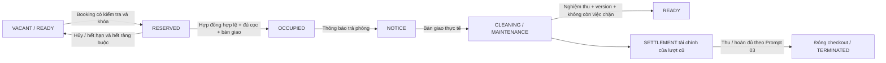

Báo cáo Prompt 04 — chống đặt phòng trùng và chuẩn hóa vòng đời phòng

Ngày thực hiện: 31/10/2026. Thay đổi trực tiếp dự án hiện có, giữ layout/theme/sidebar/header/navigation. Không commit, push, merge, xóa dữ liệu hay áp dụng migration lên database ứng dụng/production. Giữ các thay đổi của Prompt 01–03.

1. Các vấn đề phát hiện từ code và dữ liệu

Trước sửa, ba module có thể ghi trạng thái phòng: `RentalLifecycleRepository`, `AdminPropertyRepository` và `AdminTenantRepository`. Maintenance có workflow riêng nhưng chưa đồng bộ điều kiện tái khai thác phòng.

| Nơi xử lý | Phát hiện xác nhận được |
|---|---|
| Booking trong Prompt 03 | Đã có `FOR UPDATE` trên phòng và kiểm tra cam kết; không kết luận cơ chế này tự tạo booking trùng. Tuy nhiên module người thuê và chỉnh phòng vẫn có thể ghi đè trạng thái ngoài cơ chế đó. |
| `AdminPropertyServiceImpl.validateTransition` | Chỉ có graph cũ năm trạng thái. Cho `RESERVED → OCCUPIED` trực tiếp; kiểm tra `currentContract` chỉ nhìn hợp đồng ACTIVE, không kiểm tra booking/cư trú/bảo trì đầy đủ. |
| `AdminPropertyRepository.changeStatus` | Cho bỏ version khi gửi request; nguồn cập nhật trạng thái độc lập với lifecycle. |
| `AdminTenantRepository.createResidence` | Tự chuyển phòng OCCUPIED khi thêm hồ sơ, không cần hợp đồng/check-in. |
| `AdminTenantRepository.transfer/releaseRoomIfEmpty` | Chuyển vào phòng mới mà không gắn hợp đồng; giải phóng phòng dựa trên số cư trú ACTIVE, bỏ qua booking/hợp đồng/bảo trì. |
| `createContract` | Không kiểm tra giao nhau khoảng thuê hoặc cam kết khác trên phòng khi lập hợp đồng từ booking. |
| `prepareCheckin/completeCheckin` | Chưa kiểm tra phòng MAINTENANCE/CLEANING/INACTIVE, hợp đồng khác, check-in khác, ngày nhận phòng trong khoảng thuê; chỉ số đầu kỳ còn cho phép thiếu. |
| Booking hết hạn | Chưa có tác vụ nền; endpoint EXPIRED chưa kiểm tra đã đến hạn; booking đã nhận tiền chưa có cùng nhánh xử lý hết hạn. |
| Gia hạn hợp đồng | Tenant chỉ gửi yêu cầu; chưa có đường phê duyệt có kiểm tra xung đột tại thời điểm chấp thuận. |
| Thống kê và frontend | Nhiều bộ lọc chỉ có năm trạng thái; READY/NOTICE chưa được tính cùng nhóm khả dụng/đang ở trong các số liệu liên quan. |
| Maintenance | Đếm COMPLETED là đã hết việc trong một số truy vấn, trong khi quy trình thực tế còn bước nghiệm thu để thành RESOLVED. |

Đã đọc thống kê database local hiện có bằng truy vấn chỉ đọc: `rooms.status` là `VARCHAR(30) NOT NULL DEFAULT VACANT`, đang có hai phòng OCCUPIED và hai phòng VACANT; truy vấn nhóm trạng thái booking/hợp đồng không có dòng. Đây là trạng thái local tại thời điểm audit, không đại diện cho dữ liệu production. Không đổi các phòng này về trạng thái khác và không suy ra phòng OCCUPIED là thực tế trống chỉ vì thiếu hợp đồng liên kết.

2. Nguyên nhân gốc

Các module dùng trạng thái phòng như một cờ có thể ghi riêng. Cùng một phòng có thể bị nhận cư trú, chỉnh trạng thái và vận hành booking qua các kiểm tra/khóa khác nhau. Trạng thái pháp lý của hợp đồng cũng chưa được phân biệt đầy đủ với bằng chứng bàn giao thực tế. Truy vấn đọc, graph chuyển trạng thái và UI không cùng hỗ trợ đủ tám trạng thái đã xuất hiện trong lifecycle.

3. Trạng thái và quy tắc trước/sau

Giữ nguyên các tên đã có, không thay enum hay tự chuyển dữ liệu:

| Trạng thái | Ý nghĩa / nguồn hợp lệ sau sửa |
|---|---|
| VACANT | Trống, có thể nhận booking khi không còn cam kết/cư trú/bảo trì. Giữ để tương thích dữ liệu cũ. |
| READY | Đã xác nhận điều kiện khai thác, không còn công việc bảo trì chờ nghiệm thu. |
| RESERVED | Chỉ quy trình booking tạo, giữ đến khi hủy/hết hạn/nhận phòng. |
| OCCUPIED | Sau check-in; thêm người ở cùng không tạo hợp đồng độc quyền khác hoặc tự ghi trạng thái này. |
| NOTICE | Đã thông báo trả phòng nhưng chưa bàn giao; vẫn tính là phòng đang có người ở. |
| CLEANING | Đã bàn giao, cần vệ sinh; không nhận booking/check-in mới. |
| MAINTENANCE | Chưa đủ điều kiện khai thác do sửa chữa; không nhận booking/check-in mới. |
| INACTIVE | Ngừng khai thác, không nhận khách mới. |

Graph chỉnh thủ công cho phép:

- VACANT → READY / MAINTENANCE / INACTIVE.
- READY → VACANT / MAINTENANCE / INACTIVE.
- CLEANING → READY / MAINTENANCE.
- MAINTENANCE → READY / CLEANING / INACTIVE.
- INACTIVE → VACANT / MAINTENANCE.

READY cần `readinessConfirmed=true`, lý do, version mới nhất và không còn công việc bảo trì chưa nghiệm thu. Không thể lách CLEANING → VACANT để bỏ bước xác nhận. Mọi nhánh trên còn bị chặn nếu có người ở, hợp đồng hoặc booking có hiệu lực. RESERVED/OCCUPIED/NOTICE không được ghi đè thủ công; phải đi qua nghiệp vụ thuê.

`RoomLifecycleGuard.transition` là nơi thực hiện UPDATE trạng thái phòng và ghi `room_status_history` trong transaction. Các repository khác gọi qua đây; endpoint manual dùng kiểm tra riêng của `manual`. Khởi tạo phòng mới vẫn dùng trạng thái mặc định VACANT như trước.

4. Cơ chế chống booking trùng

Khóa theo thứ tự chủ sở hữu → phòng, sau đó đọc lại booking/hợp đồng/cư trú bằng locking read trong cùng transaction. Khóa chủ sở hữu tái sử dụng phạm vi khóa tài chính của Prompt 02/03 để các nghiệp vụ phòng và tiền không dùng thứ tự trái nhau ở các luồng chính.

Sau khóa, backend kiểm tra quyền khu trọ, property ACTIVE, trạng thái phòng, booking có hiệu lực, hợp đồng chưa bàn giao, cư trú ACTIVE, check-in đã hoàn thành chưa có checkout bàn giao và công việc bảo trì. Chỉ sau đó mới INSERT booking, tài khoản cọc dự kiến, chuyển phòng RESERVED và ghi lịch sử. UPDATE phòng có điều kiện trạng thái/version. Một request cạnh tranh sẽ thấy dữ liệu mới hoặc nhận lỗi 409; không tạo thêm tài khoản/giao dịch tài chính hợp lệ trùng.

Không dùng `synchronized`. Không có unique index trên `room_id` cấm lịch sử. Chính sách hiện tại vẫn là một giữ chỗ có hiệu lực cho mỗi phòng; không tự mở lịch nhiều lượt đặt tương lai.

Giữ chỗ và khoảng thuê dùng `[start, end)`: bắt đầu được tính, ngày kết thúc không được tính. `start < end`; giao nhau khi `existing.start < requested.end && requested.start < existing.end`. Booking đến `reservation_end` không được thu tiền hay lập hợp đồng nữa, kể cả scheduler chưa chạy. Booking có start trong tương lai vẫn giữ phòng ngay khi tạo theo chính sách một lượt hiện tại; không được hiểu thành tính năng đặt trước nhiều lịch.

5. Chống hợp đồng chồng lấn và gia hạn

Lập hợp đồng kiểm tra khoảng thuê với các hợp đồng cam kết chưa bàn giao, các booking khác và chiếm dụng vật lý. Booking phải còn hạn, đúng trạng thái và chưa dùng tạo hợp đồng. Cùng booking được khóa trước khi kiểm tra/tạo, nên hai nhân viên không thể tái sử dụng thành hai hợp đồng.

Gia hạn được kiểm tra khi Tenant gửi yêu cầu và kiểm tra lại khi Owner/Manager duyệt. Phê duyệt khóa cùng phòng/hợp đồng/request, kiểm tra trạng thái PENDING của request, ngày kết thúc mới và các cam kết khác, rồi cập nhật end_date, reviewer, thời gian/lý do và contract history trong một transaction. Không thay số cọc hoặc tạo thu tiền khi gia hạn.

Người đại diện nhận/chuyển phòng đi qua bàn giao và hợp đồng. Người ở cùng/người phụ thuộc được gắn vào đúng một hợp đồng đã nhận phòng của phòng đích; không tạo hợp đồng độc quyền mới. Chuyển người ở cùng không giải phóng phòng của người đại diện.

6. Booking hết hạn

`BookingExpirationScheduler` chạy mặc định mỗi 60.000 ms, cấu hình bằng `app.booking.expiration-delay-ms`. Mỗi lượt lấy tối đa 200 ID đến hạn, sau đó gọi `BookingExpirationService.expire` qua bean transaction riêng cho từng booking.

Mỗi worker khóa cùng chủ sở hữu/phòng, đọc lại booking FOR UPDATE, chỉ xử lý RESERVED/DEPOSITED chưa có contract và end <= hôm nay. Booking đã chuyển hợp đồng, đã gia hạn sang ngày khác hoặc đã hết hạn sẽ bị bỏ qua. Hai instance cùng thấy một ID chỉ tạo một lần chuyển EXPIRED/lịch sử. Một lỗi booking không rollback cả batch; lượt sau có thể thử lại.

Không tự hoàn hoặc tịch thu tiền. Số dư giữ chỗ vẫn ở ledger của Prompt 03, truy vấn qua `expired_booking_money_to_resolve`. Room chỉ được giải phóng nếu không còn cam kết/cư trú; nếu còn công việc bảo trì thì không coi là VACANT sẵn khai thác. Có API gia hạn giữ chỗ trước khi hết hạn, kiểm soát version và có lý do/lịch sử.

7. Đồng bộ check-in, checkout và bảo trì

Check-in cần hợp đồng PENDING_CONFIRMATION, ngày nhận trong khoảng thuê, đúng một booking CONTRACT_CREATED liên kết đúng phòng, không có hợp đồng/người ở/check-in khác chưa bàn giao, không có công việc bảo trì chưa nghiệm thu và đủ cọc thực nhận theo Prompt 03. Phòng không được CLEANING/MAINTENANCE/INACTIVE/OCCUPIED/NOTICE. Chỉ số điện/nước đầu kỳ bắt buộc; checklist xác minh vẫn được ghi nhưng không thay thế các điều kiện backend.

Hoàn tất check-in chuyển contract ACTIVE, booking CHECKED_IN, phòng OCCUPIED và ghi lịch sử. Gửi lại không thể complete lần hai.

Yêu cầu checkout chuyển phòng NOTICE, không VACANT. Bàn giao kiểm tra lại lượt cư trú, ngày thực tế, chốt chỉ số cuối kỳ và vẫn dùng quyết toán/ledger của Prompt 03. Sau bàn giao, phòng CLEANING hoặc MAINTENANCE, contract SETTLING, checkout SETTLEMENT; không tự READY. Tài chính có thể chưa xong. Bằng chứng checkout có actual_checkout_at giúp hợp đồng đã bàn giao không chiếm dụng vật lý phòng ở lượt mới, kể cả còn quyết toán tài chính.

Tạo/mở lại công việc bảo trì đưa phòng đang trống/sẵn sàng/vệ sinh về MAINTENANCE qua guard. Công việc trong phòng đang thuê không làm mất trạng thái OCCUPIED/NOTICE. COMPLETED/INSPECTION_PENDING còn chờ nghiệm thu; chỉ RESOLVED/CANCELLED/REJECTED được loại khỏi danh sách việc đang chặn tái khai thác. Không tạo phân hệ bảo trì thứ hai.



8. File thay đổi trong Prompt 04

Backend mới:

- `src/main/java/com/thangit/boardinghouse/service/RoomLifecycleGuard.java`
- `src/main/java/com/thangit/boardinghouse/service/BookingExpirationService.java`
- `src/main/java/com/thangit/boardinghouse/config/BookingExpirationScheduler.java`
- `src/test/java/com/thangit/boardinghouse/service/RoomLifecycleMysqlTest.java`
- `src/test/java/com/thangit/boardinghouse/controller/RoomLifecycleControllerTest.java`
- Migration V23 bên dưới.

Backend sửa, dưới `boarding-house-backend/src/main/java/com/thangit/boardinghouse/`:

- `common/exception/GlobalExceptionHandler.java`: lock/version database conflict trả HTTP 409 `CONCURRENT_UPDATE`.
- `controller/AdminContractController.java`, `controller/RentalLifecycleController.java`.
- `dto/request/property/AdminPropertyRequests.java`, `dto/request/lifecycle/RentalLifecycleRequests.java`.
- `service/AdminContractService.java`, `service/RentalLifecycleService.java`, `service/DepositLedgerService.java`.
- `service/impl/RentalLifecycleServiceImpl.java`, `AdminPropertyServiceImpl.java`, `AdminTenantServiceImpl.java`, `AdminContractServiceImpl.java`, `TenantContractServiceImpl.java`.
- `repository/RentalLifecycleRepository.java`, `AdminPropertyRepository.java`, `AdminTenantRepository.java`, `AdminMaintenanceRepository.java`, `TenantMaintenanceRepository.java`, `DashboardRepository.java`, `AdminReportRepository.java`.

Test hiện có được cập nhật constructor/fixture để đi qua check-in thật thay vì gán ACTIVE trực tiếp: `DepositLedgerMysqlTest`, `RentalLifecycleServiceImplTest`, `TenantContractServiceImplTest`, `AdminTenantServiceImplTest`. Các file này ở `boarding-house-backend/src/test/java/com/thangit/boardinghouse/service/`.

Frontend dưới `boarding-house-frontend/src/`:

- Mới: `components/admin/contracts/contract-extension-review.tsx`.
- `components/admin/contracts/contract-detail-page.tsx`.
- `components/admin/properties/room-pages.tsx`.
- `components/admin/lifecycle/rental-lifecycle-page.tsx`.
- `components/admin/tenants/tenant-form-page.tsx`, `tenant-detail-page.tsx`.
- `hooks/use-admin-properties.ts`, `hooks/use-rental-lifecycle.ts`.
- `services/admin-property.service.ts`, `services/rental-lifecycle.service.ts`.
- `lib/format.ts`.

Frontend giữ nguyên route và phong cách hiện tại. Bổ sung nhãn/bộ lọc tám trạng thái, lý do không khả dụng, xác nhận nghiệm thu READY, cảnh báo booking quá hạn, nút gia hạn giữ chỗ và duyệt gia hạn hợp đồng. Dữ liệu các màn hình liên quan được invalidate sau thao tác; lifecycle tự refresh định kỳ để nhận trạng thái scheduler. Lỗi xung đột được hiển thị và có thể tải lại dữ liệu mới.

9. Migration và API

`V23__Guard_room_lifecycle_and_report_conflicts.sql` chỉ thêm index, trường reviewer cho yêu cầu gia hạn và view đối soát. Không sửa V1–V22, không tự hủy hợp đồng/booking hoặc đổi rooms.status của dữ liệu cũ.

- Index: hợp đồng theo phòng/trạng thái/khoảng thuê; booking theo trạng thái/hạn giữ; cư trú theo phòng/trạng thái/hợp đồng; bảo trì theo phòng/trạng thái.
- `room_booking_conflicts`: chồng khoảng giữ hoặc có nhiều giữ chỗ có hiệu lực trái chính sách một lượt.
- `room_contract_conflicts`: hợp đồng độc quyền giao nhau và chưa có bằng chứng bàn giao.
- `room_lifecycle_anomalies`: phòng khả dụng nhưng còn booking/hợp đồng/cư trú, trạng thái không được hỗ trợ, READY còn việc bảo trì, phòng đang ở thiếu hợp đồng liên kết.
- `expired_booking_money_to_resolve`: booking hủy/hết hạn còn số dư hoặc cần đối soát chứng từ.

API bổ sung:

| Method/path | Nội dung |
|---|---|
| PATCH `/api/admin/rental-lifecycle/bookings/{id}/expiry` | `reservationEnd`, `reason`, `version`; chỉ booking còn hiệu lực, chưa có hợp đồng. |
| GET `/api/admin/contracts/{contractId}/extensions` | Yêu cầu gia hạn trong phạm vi Owner/Manager. |
| POST `/api/admin/contracts/{contractId}/extensions/{requestId}/approve` | `reason`; kiểm tra lịch lại và duyệt trong transaction. |

API trạng thái phòng giữ route cũ; nay bắt buộc reason/version, nhận thêm `readinessConfirmed`. API complete check-in/checkout yêu cầu chỉ số đầu/cuối kỳ. Trạng thái OCCUPIED/RESERVED/NOTICE vẫn là giá trị thật trong domain nhưng không được tạo bằng đổi status thủ công.

10. Test và kết quả thực tế

Chạy trên MySQL 8.0.46 riêng tại `127.0.0.1:33307`. Mỗi suite tạo schema mới `prompt03_test_*` hoặc `prompt04_test_*`, dùng transaction/JDBC thật, không mở schema ứng dụng để ghi. Ca concurrency dùng hai worker, hai connection và barrier bắt đầu đồng thời; không chỉ mock repository.

| Ca bắt buộc | Kiểm chứng | Kết quả |
|---|---|---|
| TC01 | Booking phòng READY | PASS |
| TC02–TC04 | Từ chối OCCUPIED/MAINTENANCE/CLEANING | PASS |
| TC05 | Hai manager cùng booking; một thành công, một 409; một booking live | PASS |
| TC06 | Hủy hợp lệ giải phóng khi không còn ràng buộc | PASS |
| TC07 | Hủy không giải phóng phòng còn hợp đồng khác | PASS |
| TC08 | Hết hạn và giải phóng đúng | PASS |
| TC09 | Hai worker expire và chạy lại chỉ có một history EXPIRED | PASS |
| TC10 | Booking đã tạo hợp đồng không bị tự expire | PASS |
| TC11 | Không tạo hai hợp đồng chồng khoảng | PASS |
| TC12 | Gia hạn xung đột bị chặn | PASS |
| TC13 | Check-in hợp lệ chuyển room OCCUPIED/contract ACTIVE | PASS |
| TC14 | Bảo trì phát sinh sau prepare chặn complete check-in | PASS |
| TC15 | Không complete check-in hai lần | PASS |
| TC16 | Thông báo trả phòng giữ NOTICE và chặn booking mới | PASS |
| TC17 | Bàn giao chuyển CLEANING hoặc MAINTENANCE | PASS |
| TC18 | Chưa xác nhận nghiệm thu không thể READY | PASS |
| TC19 | OCCUPIED không đổi VACANT thủ công | PASS |
| TC20 | Manager ngoài phân công bị từ chối | PASS ở service; contract HTTP được kiểm tra riêng |
| TC21 | Hai đổi trạng thái cùng version; chỉ một thành công | PASS |
| TC22 | Chuyển trạng thái có actor, thời gian và lý do | PASS |
| TC23 | V22 → V23 giữ booking, contract và history đã có | PASS |
| TC24 | Expire booking đã thu giữ nguyên 500.000, không tạo refund | PASS |
| TC25 | Toàn bộ test công nợ/thanh toán/cọc Prompt 01–03 | PASS trong full suite |

Các ca thêm: hai khoảng [start,end) tiếp giáp; gia hạn booking hợp lệ không expire; booking quá hạn không lập hợp đồng; hai lần tạo contract từ cùng booking; tái giữ phòng sau bàn giao/nghiệm thu trong khi lượt cũ còn quyết toán; lease EXPIRED chưa bàn giao vẫn chặn; COMPLETED maintenance chưa nghiệm thu vẫn chặn; thêm hồ sơ không tự chiếm phòng; sự cố mới đưa READY về MAINTENANCE; duyệt gia hạn chỉ một lần; người ở cùng không tạo lease mới hoặc giải phóng phòng đại diện.

| Nhóm | Kết quả cuối |
|---|---|
| Full Maven test / compile | **161 tests, 0 failures, 0 errors, 0 skipped** |
| `RoomLifecycleMysqlTest` mới | **35/35 PASS** |
| `DepositLedgerMysqlTest` Prompt 03 | **35/35 PASS** |
| `RoomLifecycleControllerTest` mới | **6/6 PASS** |
| `DepositLedgerControllerTest` | 4/4 PASS |
| Accountant Portal | 17/17 PASS |
| Tenant invoice payments | 3/3 PASS |
| Admin invoices | 1/1 PASS |
| Tenant contracts | 3/3 PASS |
| Rental lifecycle unit | 4/4 PASS |
| Admin tenant unit | 4/4 PASS |
| Flyway V1–V23 schema mới và V22 → V23 có dữ liệu | PASS |
| Frontend lint | PASS |
| Frontend TypeScript / production build | PASS; 104 trang prerender |
| `git diff --check` | PASS |

HTTP test kiểm tra version bắt buộc, nhận readinessConfirmed, meter bắt buộc, lý do gia hạn bắt buộc và cấu trúc lỗi 409 khi database khóa cạnh tranh. Đây là contract/validation test, không thay thế kiểm thử toàn bộ JWT/security filter trên trình duyệt.

Lệnh chạy từ backend, khi MySQL kiểm thử riêng đã khởi động:

```powershell
.\mvnw.cmd -q '-Dprompt03.mysql=true' '-Dprompt04.mysql=true' '-Dprompt03.mysql.port=33307' '-Dprompt03.mysql.user=root' '-Dprompt03.mysql.password=' test
```

Nếu không bật các property tích hợp, Maven bỏ qua hai suite MySQL có chủ đích. Lượt này đã bật cả hai và không có test bị skip. Dữ liệu kiểm thử được giữ tại `D:\DATN\prompt03-mysql-test-data`; tiến trình MySQL riêng được dừng khi hoàn tất.

11. Rủi ro dữ liệu lịch sử và giới hạn kiểm chứng

Booking/hợp đồng giao nhau, nhiều booking live, phòng hiển thị trống nhưng còn cư trú và trạng thái ở thiếu lease cần đối soát bằng các view mới. Phân loại giao nhau lease/booking là xung đột cam kết; trạng thái không khớp là vấn đề vận hành; cọc của booking hết hạn là nghĩa vụ tài chính chưa xử lý. Không dùng một UPDATE hàng loạt để xóa các ràng buộc này. Đặc biệt, ngày hết hợp đồng không đủ chứng minh khách đã trả phòng; phải đối chiếu check-in, cư trú và biên bản checkout thực tế.

Quy ước ngày kết thúc loại trừ cần được giải thích khi triển khai cho dữ liệu cũ đã nhập theo cách hiểu bao gồm ngày cuối. Migration không tự cộng/trừ ngày trong hợp đồng/booking cũ. Cách tính tiền và kỳ hóa đơn của Prompt 01–03 được giữ, không tự thay chính sách tài chính trong lượt này.

Khóa theo owner giúp thống nhất với nghiệp vụ tài chính nhưng có thể làm các thao tác ở nhiều phòng cùng chủ chờ nhau. Deadlock/lock timeout có thể được trả 409 để người dùng tải lại; không tự retry mù các giao dịch tiền. Kiểm thử hai worker chứng minh hành vi khóa MySQL, chưa phải benchmark nhiều backend instance hoặc tải lớn.

Chưa áp dụng V23 lên database ứng dụng/production, chưa thử trên bản sao production và chưa UAT end-to-end qua browser với tài khoản thực. Luồng nghiệp vụ được kiểm chứng bằng service/JDBC thật và API contract bằng MockMvc; không coi build là bằng chứng thay cho các ca dữ liệu. Database local chỉ được đọc thống kê, không tự xử lý các phòng legacy OCCUPIED thiếu lease.

12. Tiếp tục ở Prompt 05

Nội dung Prompt 05 chưa được cung cấp, nên không tự suy diễn một module mới. Các việc bàn giao phù hợp gồm: UAT theo từng vai trò; chạy báo cáo xung đột trên bản sao dữ liệu thực; duyệt phương án đối soát hồ sơ cũ; kiểm thử tải/đa instance và theo dõi 409; xác nhận quy ước ngày với chính sách tính tiền hiện hành; triển khai có kiểm soát sau khi dữ liệu và migration được rà soát. Nếu sau này mở lịch đặt trước nhiều lượt, cần thiết kế riêng ngày dự kiến thuê, khoảng vệ sinh/bảo trì và cam kết tương lai; không bỏ giới hạn một booking live chỉ bằng sửa UI.
