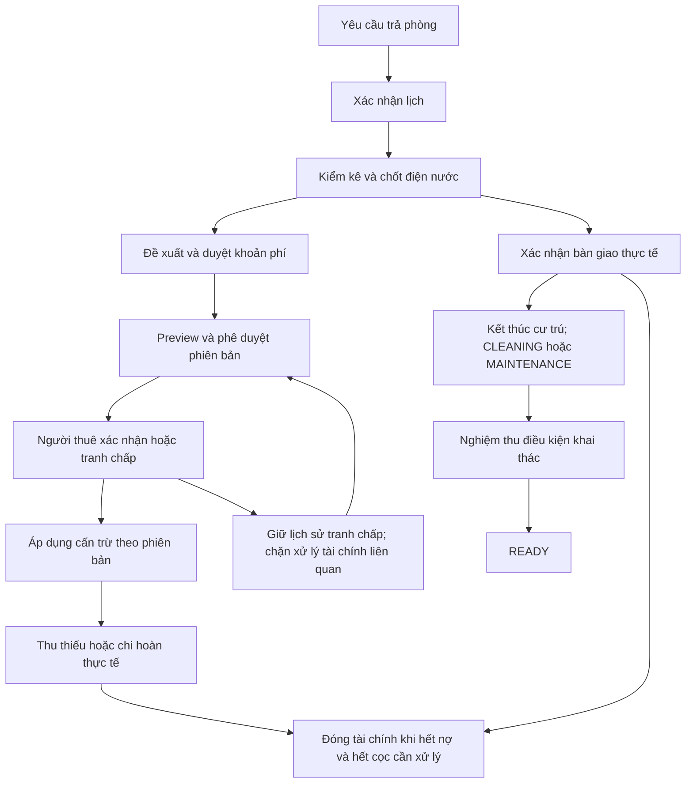

# Prompt 09 — Trả phòng, quyết toán, hoàn cọc

Ngày kiểm tra: 18/11/2026. Làm việc trên nhánh hiện có `feature/improve-business-logic`; không commit/push/merge. Không áp dụng migration vào database thật cổng 3306 hoặc khởi động lại backend thật cổng 8080.

## Thay đổi và nguồn dữ liệu

Danh sách tập trung `/admin/checkouts` và `/accountant/checkouts` có bộ lọc công ty, nhà, phòng, ngày trả dự kiến, giai đoạn, tài chính, phụ trách và tranh chấp. Backend phân trang, tổng hợp thẻ theo cùng bộ lọc và kiểm tra phạm vi. Ngày tạo yêu cầu, ngày dự kiến, ngày đã hẹn, lịch kiểm kê và ngày bàn giao thực tế hiển thị riêng.

`CheckoutWorkspace` mở lại `CheckoutSettlementPanel` theo hợp đồng nguồn. Wizard gồm 9 bước; kiểm kê và chỉ số cuối dùng cùng một phiên bản biên bản để không tạo hai nguồn chốt số. `CheckoutSteps` thể hiện dữ liệu backend, không tự chuyển trạng thái nghiệp vụ. `CheckoutEvidencePanel` lưu ảnh riêng tư, khóa retry, phân nhóm và liên kết tranh chấp cùng hồ sơ. `CheckoutPrint` tạo bản in trình duyệt từ dữ liệu nguồn, ưu tiên dòng quyết toán đã duyệt. Có thể chọn Save as PDF của trình duyệt; chưa có dịch vụ tạo PDF phía server hay chữ ký điện tử.

Tái sử dụng `AdminShell`, `AccountModal`, `PropertySelector`, `useScopedQuery`, management scope, `DepositLedgerPanel`, `CheckoutSettlementService`, `RentalLifecycle`, `RoomLifecycleGuard`, `MonthlyBillingService` và `DepositLedgerService`. API tạo yêu cầu cũ chuyển vào cùng CheckoutSettlement; không tạo quy trình tài chính song song.

Danh sách file trong [inspected-files.md](inspected-files.md) và [changed-files.json](changed-files.json) chỉ theo phạm vi Prompt 09; workspace còn nhiều thay đổi từ Prompt 01–08 được giữ lại.

## API

Mới, cùng phạm vi quyền của portal:

| API | Mục đích |
|---|---|
| `GET /api/{admin,accountant}/checkout-workspace` | Bộ lọc, phân trang, summary; không ghi tiền |
| `GET /api/{admin,accountant}/checkout-workspace/options` | Nhà, phòng, hợp đồng và nhân sự trong phạm vi |
| `POST /api/{admin,accountant}/checkout-workspace/{id}/assignment` | Phân công/lịch kiểm kê, version, lịch sử và thông báo nội bộ |
| `GET /api/{admin,tenant,accountant}/checkout-evidence/{id}` | Metadata ảnh đúng hồ sơ |
| `POST /api/{admin,tenant,accountant}/checkout-evidence/{id}` | Multipart ảnh JPEG/PNG/WebP tối đa 10 MB, Idempotency-Key; kế toán không được upload |
| `GET /api/{admin,tenant,accountant}/checkout-evidence/{id}/{file}` | Download có kiểm tra quyền, attachment, no-store, nosniff và audit |

Tái sử dụng `/api/{portal}/checkout-settlement`: GET `/contracts/{id}`, GET `/contracts/{id}/document` (text), POST root tạo yêu cầu, `/{id}/schedule`, `schedule-approval`, `inspection`, `inspection-confirmation`, `charges`, `charges/{charge}/decision`, `approval`, `confirmation`, `disputes`, `disputes/{dispute}/resolve`, `handover`, `cancel`. Áp dụng quyết toán dùng API RentalLifecycle hiện có. Thu bổ sung mở hóa đơn nguồn; duyệt/chi hoàn và đóng sổ dùng DepositLedger hiện có.

Manager phải có CONTRACT_APPROVE để xử lý, DEPOSIT_APPROVE để duyệt khoản phí/quyết toán và FINANCE_WRITE để áp dụng; đọc chi tiết tài chính cần FINANCE_READ. Danh sách che tiền và không cho mở chi tiết khi thiếu quyền đọc. Accountant chỉ xem nhà được giao và dùng luồng chi hoàn hiện có; tenant chỉ dùng hồ sơ hợp đồng của mình. Backend vẫn là nơi quyết định quyền.

## Migration

`V40__Attach_private_checkout_evidence.sql`, nối tiếp V39: thêm người phụ trách/lịch kiểm kê vào checkout và bảng ảnh MEDIUMBLOB có FK, hash, khóa retry và kiểm tra dung lượng. Không sửa migration cũ, không backfill tiền/trạng thái hoặc tạo ảnh lịch sử giả. Chỉ chạy qua Flyway trên schema kiểm thử riêng cổng 3317. Khi triển khai thật cần backup và kiểm tra cấu hình giới hạn multipart/MySQL packet theo môi trường.

## Vòng đời

Bàn giao có thể diễn ra khi tranh chấp tiền còn mở nếu đủ căn cứ biên bản; không tự coi đã quyết toán. Hợp đồng giữ dấu vết kết thúc vận hành và đóng tài chính riêng. Đóng tiền của hợp đồng cũ không đổi trạng thái phòng của lượt thuê mới. Đổi lịch xóa xác nhận lịch/kiểm kê hiện hành; lịch sử phiên bản cũ được giữ. Không được thay ngày đã xác nhận sau kiểm kê mà bỏ qua kiểm kê lại.

## Tính tiền

Toàn bộ số tiền chính thức do Java BigDecimal/MySQL DECIMAL tính. Frontend chỉ định dạng số.

- Nợ cũ: tổng remaining_amount của hóa đơn nguồn hợp lệ; không cộng lại tổng hóa đơn đã thanh toán hoặc chuyển kỳ.
- Phí mới: phần chưa lập hóa đơn trong kế hoạch cuối kỳ + khoản bổ sung đã duyệt. Tiền điện/nước dùng các đoạn công tơ và đơn giá snapshot hợp đồng. Trừ phần đã tính trên hóa đơn nguồn; không thu hai lần.
- Tiền phòng theo chính sách proration hiện có, ngày bàn giao chỉ tính khi thỏa thuận; dịch vụ theo ngày hiệu lực. Khoản đã tính dư phải đối soát theo cơ chế tín dụng/RETAIN_AS_BILLED hiện có, không tự sửa hóa đơn lịch sử hoặc tự phạt vì thiếu báo trước.
- Cấn trừ = min(cọc thực giữ, nghĩa vụ hợp lệ). Hoàn dự kiến = max(cọc thực giữ − cấn trừ, 0). Thu thiếu = max(nghĩa vụ − cấn trừ, 0). Giữ lại phải qua khoản đã duyệt theo luồng hiện có.
- Làm tròn HALF_UP theo MonthlyBilling; số tiền lưu 2 chữ số thập phân, phân bổ lượng có thể 8 chữ số. Không thay công thức trong Prompt 09.
- Preview không phát sinh hóa đơn, sổ cọc hoặc thu chi. Phê duyệt không phải thanh toán. Cấn trừ không phải tiền mặt mới. Chỉ chi hoàn hợp lệ mới giảm cọc và quỹ.
- Request/charge/file retry cùng nội dung trả về nguồn đã có. Nội dung khác, version cũ, hash cũ, phạm vi sai hoặc ngân hàng chưa đối soát bị từ chối theo nghiệp vụ; không nới validation để qua test.

## Kiểm thử và giới hạn bằng chứng

Kết quả cuối: 323 ca backend khác nhau đạt (322 ca hồi quy và chạy lại 30 ca workspace trên mã cuối, có thêm một ca mới); 39 ca Node và 11 ca browser đạt. Lint, TypeScript, production build và diff whitespace check đạt. Maven lần chốt báo BUILD SUCCESS, exit 0. MySQL kiểm thử 3317 đã dừng sau khi kiểm thử; schema được giữ để tra cứu lại.

Kết quả lệnh và số ca thực chạy được ghi ở [verification.json](verification.json). Danh sách tên kiểm thử backend trong [backend-cases.json](backend-cases.json). Ảnh [desktop](desktop.png), [mobile](mobile.png), [PDF fixture do Chrome in](fixture-print.pdf). Browser dùng fixture cô lập, chặn API 8080, không ghi dữ liệu thật; số tiền trong fixture chỉ phục vụ kiểm tra giao diện. Nghiệp vụ tiền được kiểm tra riêng trên MySQL thật ở cổng kiểm thử 3317.

Ca gửi đồng thời ban đầu phát hiện truy vấn đọc theo snapshot MySQL cũ dù hợp đồng đã khóa. Đã đổi sang SELECT FOR UPDATE cho yêu cầu hiện có; kiểm thử đồng thời xác minh chỉ một hồ sơ. Hai kiểm thử cũ từng yêu cầu báo lỗi khi retry đã đổi sang kiểm tra cùng ID, không tăng version/lịch sử và vẫn chặn nội dung khác; không bỏ kiểm tra trùng nguồn.

| TC Prompt 09 | Bằng chứng và phạm vi |
|---|---|
| 01–04 | Tenant request end-to-end, requestDoesNotCloseContractOrOccupancy, scheduleAndInspectionAreDerivedPhases; hiển thị các ngày riêng |
| 05–06 | tc08_inventoryUsesCheckinSnapshotNotCatalogue; privateEvidenceRetryKeepsOneFileAndNoMoneyEvent, privateEvidenceCannotCrossOwnerTenantOrCheckout |
| 07–08 | tc09_unconfirmedDamageDoesNotCreateDebt; managerNeedsDepositApprovalForSettlementApproval và capability backend |
| 09–12 | tc11_finalMetersArePersisted, tc12_onlyUnbilledConsumptionIsCharged, replacedMeterFinalReadingBelowCheckinStillUsesAllSegments |
| 13–15 | tc13_dailyRentIncludesHandoverOnlyWhenAgreed, tc14_alreadyBilledServiceIsNotRepeated; chưa kiểm tra thủ công mọi tổ hợp điều khoản thực tế |
| 16–18 | tc15_oldDebtIsNotDuplicatedIntoSettlementInvoice, tc16_threeMillionDepositOneMillionObligationRefundsTwoMillion, tc09; preview không ghi tiền |
| 19–21 | managerNeedsDepositApprovalForSettlementApproval, staffRequestDoesNotImpersonateTenantConsent, paymentAfterApprovalRequiresNewReview; changingConfirmedDateRequiresFreshInspection |
| 22–24 | disputedRequestCannotBePresentedAsCompleted, openDisputeBlocksRefundAndFinancialClose; lịch sử nguồn giữ nguyên |
| 25–29 | tc18_offsetCannotExceedRealDeposit, tc24_parallelCheckoutHasOneSettlement, tc19_refundReplayHasOneActualPayout, tc20_refundRequestIsNotActualCash, DepositLedger partial/full refund |
| 30–31 | tc17_debtAboveDepositRemainsCollectible; bankReceiptRequiresReconciliation, bankReferenceCannotBeReusedAcrossDepositAndRent. Chưa thử ngân hàng thật |
| 32–36 | physicalHandoverDoesNotPretendFinancialCompletion, tc23_tenantCanStillSeeUnpaidInvoiceAfterHandover, tc27/tc28, tenantRequestToRealRefundClosureAndAcceptedReadyRoom |
| 37 | closureKeepsHistoricalResidenceAndOriginalProfile; tc26_allLinkedResidentsMoveOut |
| 38 | PARTIAL: xác minh hồ sơ gốc không bị xóa; chưa chạy hành trình khách cũ đặt lại qua UI từ đầu đến cuối |
| 39–40 | Owner/Manager redaction, tenant scope, accountant assignment tests; chưa UAT đồng thời bốn trình duyệt vai trò thật |
| 41–42 | approvedDocumentUsesOnlyScopedSnapshot, download no-store/attachment; browser kiểm tra nội dung bản in, không có trường identity, CSS media print và xuất PDF bằng Chrome. Chưa đối chiếu trên mọi trình duyệt |
| 43–45 | concurrentRequestsKeepOneCheckout, concurrentInspectionEditsKeepOneAcceptedVersion, tc24_parallelCheckoutHasOneSettlement, tc25_failedCheckoutRollsBackAllTables, refund rollback |
| 46–47 | Browser reload, API error không giữ hàng cũ, desktop/mobile 390px không tràn trang; chưa kiểm tra mọi kích thước thiết bị |
| 48–49 | Regression DepositLedger, ManagementFinance, InvoiceFinanceWorkspace, ManagementReport; kết quả thực tế trong verification.json |
| 50 | PARTIAL: hồi quy Operations/bảo mật và kiểm thử frontend hiện có; chưa chạy toàn bộ hành trình Prompt 01–08 trên dữ liệu thật |

Không suy diễn bảng này thành 50/50 UAT PASS. Các ca tự động chỉ PASS khi lệnh tương ứng trong verification.json kết thúc thành công.

## Phần còn thiếu và đề xuất Prompt 10

Chưa tích hợp ngân hàng thật, PDF server/chữ ký số, email/SMS, antivirus/object storage hoặc ảnh xem trước inline. Ảnh tải về riêng tư; tham chiếu `FILE-id` được nhập vào trường chứng cứ nghiệp vụ hiện có. Tệp lịch sử kiểu tham chiếu text chưa được tự động biến thành ảnh. Lịch sử cư trú giữ nguồn hiện có, không tạo kho khách cũ riêng.

Cần UAT khách cũ quay lại, bốn vai trò cùng hồ sơ, in/PDF trên thiết bị mục tiêu và toàn bộ Prompt 01–08. Với dữ liệu lớn cần đo query summary theo bộ lọc và kích thước ảnh; hiện lưu ảnh trong database. Prompt 10 nên ưu tiên UAT triển khai, tối ưu lưu chứng cứ, bản in ký số nếu có yêu cầu pháp lý và đối soát ngân hàng thật. Những phần này không được báo là đã hoàn thành trong Prompt 09.
