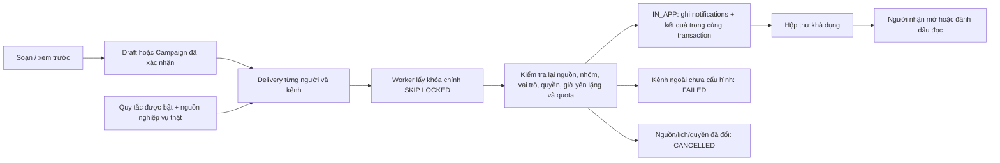

# Prompt 10 — Thông báo, lịch công việc và nhắc việc

Ngày thực hiện: 18/11/2026. Nhánh đang làm việc: `feature/improve-business-logic`; giữ nguyên thay đổi Prompt 01–09. Không chuyển nhánh bẩn, commit, push hoặc merge. Không phát thông báo trên dữ liệu/tài khoản thật. Database thật 3306 và backend thật 8080 không được migration hoặc khởi động lại trong công việc này.

## Kiểm tra hiện trạng

Có bảng `notifications`, `notification_preferences` từ V3/V14; hộp thư, đọc/đánh dấu đọc và tùy chọn người thuê đã có implementation. Kế toán/kỹ thuật có trang thông báo riêng; header quản trị trước đây chỉ dẫn tới cảnh báo dashboard. Các phân hệ hóa đơn, thanh toán, hợp đồng, bảo trì, checkout và hoàn cọc đã tạo thông báo IN_APP trong transaction nghiệp vụ. Hai scheduler cũ xử lý billing và booking, không phải hệ thống delivery/retry.

Không tìm thấy JavaMail/SMTP sender, SMS hoặc Zalo adapter thực tế trong implementation. Không coi environment variable hoặc một endpoint là bằng chứng gửi thành công. Không có message broker/outbox/delivery attempts/template/calendar công việc tổng hợp tương đương trước thay đổi này. Lịch sử invoice/debt reminder cũ vẫn thuộc phân hệ nguồn, không được backfill thành “provider đã gửi”.

Danh sách file đã kiểm tra: [inspected-files.md](inspected-files.md). File thay đổi trong Prompt 10: [changed-files.json](changed-files.json). File test và tên ca: [backend-cases.json](backend-cases.json).

## Giao diện

`CommunicationWorkspace` có hộp thư, soạn/xem trước, bản nháp/xếp hàng, lịch sử theo từng người/kênh, mẫu, lịch ngày/tuần/tháng/danh sách, quy tắc tự động và kênh/tùy chọn. Quyền quản lý/gửi được backend trả theo từng nhà; backend tiếp tục kiểm tra khi thực hiện. Bộ lọc nhà đồng bộ với ManagementScope/AccountantScope. Đổi nhà xóa preview, lựa chọn mẫu và editor đang mở.

`CommunicationBell`/`CommunicationBadge` dùng API unread/recent thật, key theo user/role, polling 60 giây, loading/error, dropdown và đường vào hộp thư. Không dùng độ dài một trang thông báo để suy ra toàn bộ unread. Khi mất phiên không render thông báo cũ. Nội dung được React render như văn bản, không dùng HTML động.

Các route:

- `/admin/communications`: Owner/Manager, dùng AdminShell.
- `/accountant/notifications`: dùng layout kế toán hiện có.
- `/technician/notifications`, `/technician/calendar`: dùng layout kỹ thuật hiện có.
- `/tenant/notifications`: dùng TenantShell; trang chi tiết/tùy chọn cũ vẫn giữ để tương thích. `/tenant/notifications/archive` dẫn tới hộp thư nâng cao cũ để tiếp tục lưu trữ, khôi phục và xác nhận thông báo.

Tái sử dụng `PageHeader`, `PageToolbar`, `SummaryCard`, `Pagination`, `LoadingSkeleton`, `ErrorState`, `AccountModal`, `AccountField`, `NumberInput`, `useScopedQuery`, các shell và scope. Ngày giờ mặc định trên form theo Asia/Ho_Chi_Minh. Các kênh bên ngoài bị vô hiệu hóa trên form khi chưa có provider.

## API

Mọi API mới ở `/api/communications`, yêu cầu phiên đăng nhập hợp lệ; service kiểm tra người dùng/phạm vi/quyền, không chỉ dựa vào prefix URL.

| API | Chức năng |
|---|---|
| GET `/options`, `/audience?propertyId=` | Phạm vi, quyền theo nhà, kênh, sự kiện, nhóm nhận hợp lệ; không trả email/điện thoại |
| GET `/inbox`, `/unread` | Hộp thư cá nhân phân trang/bộ lọc và số chưa đọc |
| POST `/inbox/{id}/read`, `/inbox/read-all` | Đọc đúng thông báo của chính người dùng |
| POST `/preview` | Kiểm tra người nhận, số lượt gửi, hash và nội dung thay biến; không tạo delivery |
| POST `/campaigns` | Lưu bản nháp hoặc yêu cầu gửi có key retry/hash |
| POST `/campaigns/{id}/queue`, `/cancel` | Xếp hàng bản nháp hoặc hủy lượt chưa thực hiện, có version |
| GET `/history`, `/deliveries/{id}/attempts` | Lịch sử riêng từng người/kênh, summary backend và từng lần thử |
| POST `/deliveries/{id}/retry` | Thử lại cùng delivery, chỉ lỗi retryable và chưa hết ngân sách |
| GET/POST `/templates`, PUT `/templates/{id}` | Mẫu văn bản, phiên bản và bật/tắt |
| GET/POST `/rules`, PUT `/rules/{id}` | Mốc nhắc, giờ gửi, nhóm nhận, giới hạn ngày, version và bật/tắt |
| GET `/calendar` | Projection nguồn + việc thủ công; tối đa 93 ngày/lần đọc |
| POST `/tasks`, PUT `/tasks/{id}`, GET `/tasks/{id}/history` | Công việc, phân công, tiến độ, hủy và lịch sử |
| GET/PUT `/preferences` | Khung giờ không làm phiền, kiểm tra version |

API cũ tenant notifications/preferences được giữ. Hai API reminder hóa đơn admin/kế toán được siết: không nhắc draft/đã hủy/đã trả đủ, khóa invoice khi kiểm tra, một nhắc thủ công cùng invoice trong ngày, reference đến invoice thật. IN_APP cũ vẫn ghi hộp thư trong transaction, không gửi network trong nghiệp vụ tiền.

Lưu tùy chọn cũ và mới cùng khóa user và kiểm tra version; client cũ không được ghi đè quiet hours mới bằng version đã lỗi thời. Có unit test từ chối ghi đè và giữ các quyền archive/acknowledge trước đây.

## Migration và kiến trúc

V41 `Create_communication_outbox_and_work_calendar`: mở rộng content thông báo để giữ văn bản, liên kết delivery duy nhất; thêm templates, rules, campaigns, deliveries, attempts, operational_tasks và audit. Không thay V1–V40, xóa lịch sử, sửa số tiền hoặc backfill trạng thái gửi của dữ liệu cũ. Chỉ áp dụng vào schema MySQL kiểm thử riêng cổng 3317. Khi triển khai thật cần migration V41 trước khi dùng API/UI mới.

Scheduler mặc định mỗi 60 giây, tắt được bằng `app.scheduling.enabled=false`. Không thêm Redis/Kafka/RabbitMQ. Dữ liệu job nằm trong MySQL, không nằm trong bộ nhớ scheduler. Mỗi lượt quét tối đa 100 rule, ưu tiên `last_scanned_at` để các rule sau không bị bỏ đói. Mỗi worker chọn tối đa 100 candidate và khóa tối đa 25 delivery bằng khóa chính, tránh khóa khoảng ở index trạng thái; khóa user theo thứ tự để serialize quota trong cùng phạm vi. Transaction rollback giữ lại job cũ, không có nửa notification/nửa attempt.

Khóa tự động: rule + loại nguồn + source ID + phiên bản lịch/mốc nguồn + recipient + channel, băm SHA-256, UNIQUE tại database. Manual request có key theo actor, hash nội dung/người nhận và ý định draft/send. Retry giữ nguyên delivery/business key; không reset attempt_count. Lỗi tạm thời tối đa 3 lần, backoff 1 rồi 5 phút, lưu từng attempt. Lỗi vĩnh viễn/unconfigured không tự retry. UNKNOWN không tự gửi lại khi chưa đối soát. Không lưu exception message/raw response/token vào attempt; chỉ mã lỗi và reference đã kiểm tra định dạng. Log scheduler chỉ ghi số lượng và loại exception.

Lỗi đồng thời ban đầu được phát hiện từ fixture REPEATABLE READ có job FAILED/UNKNOWN cũ: khóa range index chặn cập nhật status. Đã đọc deadlock graph và chuyển sang lấy candidate không khóa rồi khóa PK với SKIP LOCKED. Production worker còn khai báo READ_COMMITTED; kiểm thử đồng thời vẫn giữ fixture RR để kiểm tra thêm trường hợp này.

## Sự kiện và nguyên tắc nguồn

| Sự kiện | Nguồn thật / mốc |
|---|---|
| INVOICE_ISSUED | Invoice đã phát hành, issued_at, còn phải thu |
| PAYMENT_OPEN | payment_available_from |
| INVOICE_BEFORE_DUE / DUE / OVERDUE | due_date + offset cấu hình, remaining_amount > 0 |
| PAYMENT_CONFIRMED | Payment CONFIRMED, paid_at |
| CONTRACT_EXPIRY | Contract còn hiệu lực vận hành, end_date hiện tại |
| CHECKIN | Biên bản chưa nhận thực tế và scheduled_date hiện tại |
| CHECKOUT | Checkout chưa bàn giao, ngày xác nhận/dự kiến/lịch kiểm kê hiện tại |
| MAINTENANCE_CREATED | Yêu cầu nguồn đã tạo |
| MAINTENANCE_ASSIGNED | Phân công đang hiệu lực và thời gian assignment thật |
| MAINTENANCE_DUE / URGENT | SLA / khẩn cấp chưa được tiếp nhận |
| MAINTENANCE_COMPLETED | completed_at của nguồn; không coi là đã nghiệm thu |
| DEPOSIT_REFUNDED | Deposit transaction REFUND + CONFIRMED, không dùng yêu cầu hoàn chưa chi |
| TASK | Phiên bản công việc thủ công thực sự đã lưu; thông báo cho người được giao |

Rule không được seed bật mặc định. Event tức thời cũ không được phát lại chỉ vì vừa bật rule. Invoice đã trả, bị hủy, contract đổi hạn/kết thúc, checkout đổi lịch, nhân viên đổi hoặc vai trò bị thu hồi được kiểm tra trước phát. Scanner cũng kiểm tra các job chờ của rule để hủy lịch nguồn lỗi thời; cập nhật theo batch. Sau khi xếp hàng, worker kiểm tra lại đúng nhóm ban đầu, không chỉ kiểm tra người đó còn một tư cách bất kỳ trong nhà.

Thông báo không sửa invoice, remaining_amount, hợp đồng, cư trú, trạng thái phòng hoặc nghiệm thu bảo trì. Calendar đọc trực tiếp nguồn và phân biệt `SOURCE`/`MANUAL`; không tạo bản sao công việc cho mọi sự kiện. Việc thủ công có request key, version, người phụ trách trong phạm vi và lịch sử; kỹ thuật chỉ cập nhật tiến độ/ghi chú của việc được giao, không tự sửa phạm vi/phân công.

## Kênh và trạng thái

| Trạng thái | Ý nghĩa |
|---|---|
| DRAFT | Campaign chưa có delivery |
| SCHEDULED / QUEUED | Đã lưu lịch/đợi worker, chưa gửi |
| SENDING | Đang xử lý trong transaction; crash rollback về trạng thái trước |
| DELIVERED với IN_APP | Notification đã khả dụng trong database inbox, chưa khẳng định đã đọc |
| SENT / DELIVERED với provider | Chỉ dành cho phản hồi provider có thể kiểm chứng; chưa có adapter production |
| FAILED | Lỗi, gồm CHANNEL_NOT_CONFIGURED; xem retryable/attempt_count |
| UNKNOWN | Chưa rõ kết quả, cần đối soát, không tự retry |
| SIMULATED | Chỉ test boundary; không tính là gửi thật |
| CANCELLED | Hủy thủ công hoặc nguồn/phạm vi đã không còn phù hợp |
| READ | Không ghi đè delivery status; lấy riêng từ notifications.read_at |

Provider tích hợp thật trong phạm vi này: database IN_APP. Email/SMS/Zalo: chưa cấu hình/chưa có adapter, không phát network, không chạy thử trên tài khoản thật. `CommunicationSender` là boundary và adapter unconfigured; test transient/timeout chỉ dùng stub trong test. Trước khi thêm network adapter phải tách dispatch bên ngoài transaction, bổ sung lease/idempotency của provider và đối soát callback; không chỉ cắm một sender network vào vòng xử lý hiện tại.

Giới hạn phát của queue: 1–5/ngày/người/nhà theo rule, manual mặc định 5; IN_APP mới tuân thủ quiet hours. Tùy chọn phân loại cũ được đọc lại; các thông báo quan trọng giữ chính sách bắt buộc. API nhắc thủ công cũ có giới hạn riêng một lượt/invoice/ngày. Không xóa thông báo đã có khỏi hộp thư khi người dùng đổi tùy chọn.

## Kiểm thử thực tế

Kết quả cuối theo báo cáo suite mới nhất: **391 ca backend đạt**, 39 ca Node và 13 ca browser đạt. Lint đạt (0 error, còn một warning helper `fill` không dùng trong script checkout từ Prompt 09); TypeScript và production build đạt. Các lần chạy lại mục tiêu báo Maven exit 0. MySQL kiểm thử 3317 đã dừng, các schema được giữ lại để kiểm tra; database thật chưa áp dụng V41.

[verification.json](verification.json) ghi kết quả và số ca thực chạy; [browser-result.json](browser-result.json) ghi các luồng browser. Browser chặn mọi API 8080 bằng fixture, không ghi dữ liệu thật. Tiền và state machine được hồi quy riêng bằng MySQL thật trong schema kiểm thử. Ảnh [desktop](desktop.png), [mobile](mobile.png).

Lần hồi quy tổng hợp chạy 388 ca có một lỗi host `java.net.BindException: Address already in use: connect` do cạn socket Windows trong ManagementReport; không có assertion tài chính sai. Nhóm liên quan được chạy lại riêng và đạt. Không ghi lần lệnh lỗi đó là PASS. Bộ outbox cuối được chạy lại sau sửa khóa và phạm vi nhóm nhận; số ca chính xác trong verification.json.

| TC | Bằng chứng / phạm vi |
|---|---|
| 01–03 | inAppQueueIsNotDeliveredUntilWorker, inboxOwnershipAndReadAreSeparate, markAllReadNeverChangesOtherUsers |
| 04–05 | Browser bell/read/đổi vai trò; Node session-security kiểm tra logout/cancel/cache. Chưa UAT hai tài khoản thật cùng trình duyệt |
| 06–08 | Manual recipient selection/hash/idempotency, foreign recipient/room tests; externalFailureCannotStopInAppForSameCampaign |
| 09–11 | Ba test riêng EMAIL/SMS/ZALO unconfigured không báo SENT |
| 12–16 | transientRetryIsBoundedAndUsesSameBusinessKey, unknownProviderOutcomeIsNotAutomaticallyRetried, rawProviderSecretsAreNotStored, thrownProviderFailureIsBoundedAndSanitized. Provider là stub, không phải mạng thật |
| 17 | PARTIAL: source issued_at/legacy phát hành được kiểm tra, chưa chạy browser phát hành invoice đến rule INVOICE_ISSUED từ đầu tới cuối |
| 18–20 | paymentWindowMilestoneUsesOpeningDate, futureMilestoneDoesNotSendEarly, paidBeforeDeliveryCancelsReminder |
| 21 | Hồi quy invoice/payment; notification không chặn invoice quá hạn. Chưa UAT ngân hàng thật |
| 22–24 | repeatedSchedulerHasOneBusinessReminder, cancelledInvoiceIsNotReminded, legacyEndpointCannotRemindFullyPaidInvoice; actor/recipient scope và JWT tests |
| 25–27 | contractExtensionReplacesOldReminder, terminatedContractDoesNotSendOldExpiry |
| 28–29 | PARTIAL: projection CHECKIN và fingerprint scheduled_date có implementation; chưa có hành trình browser đổi lịch nhận phòng đầy đủ |
| 30–32 | checkoutRescheduleInvalidatesOldReminder, refundRequestWithoutPayoutCreatesNoSuccess, hồi quy checkout/deposit |
| 33–34 | PARTIAL: event/binding bảo trì hiện có được kiểm tra, source due/urgent/đổi kỹ thuật có test; chưa chạy toàn hành trình tenant tạo bảo trì → quản lý phân công qua browser |
| 35–40 | sourceCalendarShowsOnlyAssignedTechnicianJobs, unrelatedEmployeeCannotEditTask, maintenanceDueAlertsDoNotCompleteOrInspectSource, sourceCalendarNeverCreatesManualDuplicates, manualTaskRetryDoesNotDuplicate, manualWorkKeepsHistoryAndVersion; browser tạo việc và xem lịch. UAT toàn bộ sửa lịch/tiến độ trên bốn vai trò còn cần thực hiện |
| 41–43 | twoWorkersCannotCreateTwoInboxCopies, reconstructingWorkerKeepsQueuedJobs, rollbackLeavesNoInboxOrAttempt; hai transaction/kết nối DB thật, chưa chạy hai process backend production độc lập |
| 44–47 | Browser API error; CommunicationController validation; JWT anonymous/history/read/foreign property; htmlAndUnknownTemplateVariablesAreRejected; revokedRecipientRoleIsNotRescuedByOtherMembership |
| 48–49 | Browser desktop/mobile 390px; production không chứa fixture sender/thông báo giả, chỉ IN_APP thật + external unconfigured |
| 50 | PARTIAL: các bộ checkout, cọc, invoice, finance, report, operations, security và frontend được chạy; chưa phải toàn bộ UAT Prompt 01–09 |

Không quy đổi bảng này thành “50/50 UAT PASS”. Các mục PARTIAL/cần UAT không được tính thành kiểm chứng hoàn chỉnh.

## Hạn chế và Prompt 11

- Không có SMTP/SMS/Zalo gửi thật, callback delivery/read, chi phí provider, file đính kèm hoặc realtime push. Không có secret provider trong frontend.
- Templates dùng cho soạn thủ công; nhắc tự động hiện dùng nội dung văn bản có sẵn theo sự kiện, chưa có editor chọn template tùy biến riêng cho từng rule. Biến không có dữ liệu nguồn trong thông báo chung hiển thị “—”, không suy diễn số tiền.
- Nhóm tenant lấy đại diện các hợp đồng hoạt động/đang quyết toán có tài khoản, không tự tạo tài khoản cho mọi người ở cùng. IN_APP cũ vẫn ở inbox; delivery statistics mới chỉ tính outbox mới, không gán SENT cho lịch sử không đủ bằng chứng.
- Mỗi loại nguồn/rule lấy tối đa 1000 dòng; calendar manual tối đa 1000 dòng trong khoảng xem. Cần benchmark/pagination nguồn trước khi dùng nhà trọ có quy mô vượt mức này. Calendar tháng là nhóm ngày có sự kiện, không phải bộ lịch kéo thả.
- Tạm hoãn quiet hours theo từng giờ; không có bypass khẩn cấp ngoài chính sách được cấu hình. Việc tự động lấy từ projection, chưa sinh thêm nhiệm vụ thủ công cho thiếu chỉ số điện nước/kiểm kê tài sản.
- Cần UAT thật bốn vai trò, check-in thay lịch, bảo trì từ tạo đến nghiệm thu và toàn bộ Prompt 01–09. Cần đo tải, quan sát backlog/failed jobs, retention cho attempts/audit và xử lý nâng cấp schema trên môi trường triển khai.
- Prompt 11 nên ưu tiên các UAT còn thiếu, phân trang nguồn lớn, lựa chọn template cho rule, sau đó tích hợp provider hợp lệ với dispatch ngoài transaction, lease, idempotency, callback, đối soát UNKNOWN và kiểm thử sandbox trước khi bật production.
